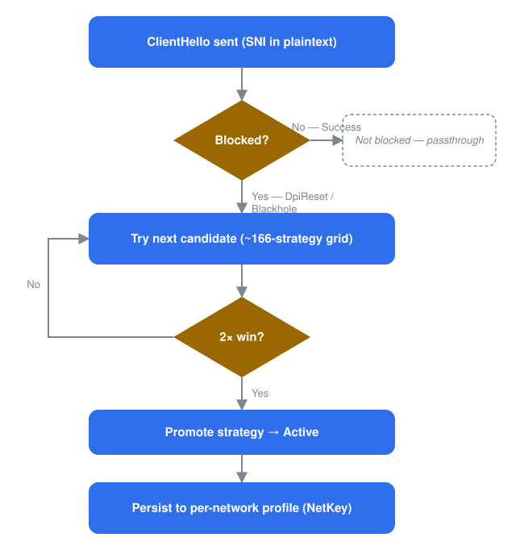

# Bosphorus

[](https://github.com/Dark-Hunter-TR/Bosphorus/actions/workflows/build.yml)

**A self-learning DPI (Deep Packet Inspection) bypass engine for Windows.**
Bosphorus watches your outbound HTTPS connections, automatically works out which
packet trick defeats the censor on *your* network for *each* site, locks that
trick in, and remembers it per network — with zero manual tuning.

**Languages:** **English** · [Türkçe](README.tr.md) · [Русский](README.ru.md)

> ⚠️ **Legal note.** Bosphorus is a network-research and censorship-circumvention
> tool. Use it only on networks and traffic you are authorised to test. You are
> responsible for complying with the laws and regulations that apply to you.

---

## Table of contents

- [What Bosphorus is](#what-bosphorus-is)
- [How it works, in short](#how-it-works-in-short)
- [How it works, in detail](#how-it-works-in-detail)
  - [The capture path](#the-capture-path)
  - [Connection tracking & verdicts](#connection-tracking--verdicts)
  - [The discovery lifecycle](#the-discovery-lifecycle)
  - [Per-network memory (NetKey)](#per-network-memory-netkey)
  - [ISP seed pool](#isp-seed-pool---isp-name-opt-in)
  - [QUIC and HTTP/3](#quic-and-http3)
  - [Live network switching](#live-network-switching)
- [The evasion toolbox](#the-evasion-toolbox)
- [The discovery grid](#the-discovery-grid)
- [Project layout](#project-layout)
- [Requirements](#requirements)
- [Building from source](#building-from-source)
- [Cutting a build](#cutting-a-build)
- [Command-line usage](#command-line-usage)
- [Running as a Windows Service](#running-as-a-windows-service)
- [Files, folders & logs](#files-folders--logs)
- [Safety & design decisions](#safety--design-decisions)
- [Limitations & out of scope](#limitations--out-of-scope)
- [Credits & attribution](#credits--attribution)
- [License](#license)

## What Bosphorus is

Many networks run a middlebox that inspects the plaintext **SNI** (server name)
in the TLS `ClientHello` and drops or resets connections to blocked hosts. Tools
such as **GoodbyeDPI** and **zapret** defeat this by splitting, reordering, or
shadowing that first packet so the middlebox never sees a clean SNI while the
real server still does — but they expect *you* to pick a strategy and hope it
matches your ISP's censor.

Bosphorus removes that step. It watches, learns, and remembers automatically —
see [how it works](#how-it-works-in-short) below.

It ships as a Rust workspace: a portable core engine, a thin WinDivert wrapper,
and a CLI that can also install itself as a Windows Service.

## How it works, in short



1. **Watch.** The very first packet of an HTTPS connection — the `ClientHello`,
   which carries the site's name in plain text — is let through untouched, and
   Bosphorus watches what comes back.
2. **Detect.** A normal reply means the site isn't blocked; nothing else
   happens. A reset, or silence, marks that site as blocked.
3. **Search.** For a blocked site, Bosphorus works through a list of about 166
   packet tricks — splitting the handshake, sending decoy packets, playing
   games with the packet's TTL — automatically. It never opens test
   connections of its own: it uses the retries your browser or app already
   makes.
4. **Lock in.** The first trick that proves itself twice in a row for that
   site is saved and reused for every later connection to it.
5. **Remember.** The learned tricks are written to a small file tied to the
   network you're on. Rejoin that Wi-Fi later and they're already in place —
   nothing re-learns from scratch.

The rest of this section goes into the mechanics; skip to
[the evasion toolbox](#the-evasion-toolbox) if you just want the list of
tricks.

## How it works, in detail

Every packet — inbound or outbound — passes through one WinDivert handle and
three internal stages:

- **conntrack** turns raw packets for one connection into a verdict: did the
  handshake succeed, get reset, or time out?
- **discovery** uses that verdict to pick the next candidate strategy for this
  specific site from the grid, or to lock in one that already proved itself.
- **transforms** turns the chosen strategy into the actual batch of packets
  sent instead of (or alongside) the original one.

Whatever discovery learns is periodically written to a small JSON file, keyed
to the network you're currently on (see [NetKey](#per-network-memory-netkey)).

### The capture path

A single WinDivert handle at the `NETWORK` layer captures a deliberately
narrow slice of traffic (filter fragments taken verbatim from GoodbyeDPI):

- **Outbound** TCP to port 443 that looks like a request or a TLS handshake
  (payload under 1200 bytes, or starting with `GET `/`POST`, or a TLS record
  header).
- **Inbound** from port 443 that carries a verdict signal: the `SYN`+`ACK`
  (its TTL tells us the server's stack and hop count), a `RST`, or the first
  data segment starting with `0x16` (a `ServerHello`).
- Loopback and private/link-local address ranges are excluded on both sides.

Everything else on the machine is untouched. Non-IP and non-TCP packets pass
straight through. The per-packet loop runs inside `catch_unwind`, so a single
malformed packet degrades to one log line rather than killing the process. If a
transform panics, its partial send batch is discarded, the original bytes and
metadata are restored, and that original packet is forwarded.

### Connection tracking & verdicts

Every captured packet updates a per-connection state machine. Once the
outcome is certain, the connection is classified:

| Verdict | Meaning |
|---|---|
| `Success` | The handshake got through **and held** — either real data flowed, or a short grace window passed with no teardown. |
| `DpiReset` | A `RST` came from the server after our `ClientHello`, before any `ServerHello` — the classic in-path reset. |
| `LateReset` | The `ServerHello` got through, then a reset tore the connection down inside the grace window — a "delayed reset" censor. Counted as a failure. |
| `Blackhole` | `ClientHello` sent, nothing came back at all. |
| `TlsError` | A setup failure that isn't a clean DPI reset. |
| `Inconclusive` | Nothing decisive happened before the connection aged out. |

`Success` is deliberately deferred by a short (~1 s) grace window, so a
censor that lets the `ServerHello` through and *then* resets the connection
is caught as `LateReset` instead of being banked as a success too early. Real
inbound data short-circuits that wait immediately.

### The discovery lifecycle

Discovery tracks state **per target** — a target being the lowercased site
name (SNI) from the `ClientHello`. A handshake with no readable site name
(already fragmented, or using Encrypted Client Hello) is never touched and
never becomes a target.

A target moves through four phases:


1. **Probe** — the first connection to a new site passes through unchanged, to
   see whether it's actually blocked. A success moves it to **Active** with no
   strategy needed. A `DpiReset` or `Blackhole` moves it to **Discover**.
2. **Discover** — the grid is swept one candidate at a time. Concurrent
   connections to the same site are handed *different*, untried candidates in
   parallel, so the sweep goes as fast as the app itself retries. Once *one*
   specific candidate produces two of its own successes in a row (a different
   candidate succeeding once in a parallel connection doesn't count toward
   this), it's promoted and the target moves to **Active**.
3. **Active** — the promoted strategy (or plain passthrough, for a site that
   was never blocked) is used for every connection. Three failures in a row
   demote it back to **Discover**, and the sweep restarts.
4. **Exhausted** — every candidate has been tried and none worked. If a later
   build ships a bigger grid, an exhausted target automatically revives into
   **Discover** to try only the new candidates — old attempts aren't repeated.

A few details that make the sweep practical:

- **Transient failures are forgiven once.** A `DpiReset` (a deliberate reset)
  rules a candidate out immediately, but a `Blackhole` — which can just be
  momentary packet loss — gets one more try before being ruled out.
- **Retransmit-aware.** Once a strategy has been sent for a connection, a
  later retransmit of the same `ClientHello` is forwarded untouched, so it's
  never desynced twice (which would just corrupt it further).
- **Bounded memory.** Idle, never-blocked targets are dropped after 24 hours,
  any target after 7 days, and a hard cap of 4096 tracked targets is enforced
  worst-value-first — so a service running for weeks doesn't grow one record
  per site ever contacted.

### Per-network memory (NetKey)

Learned state is saved as one JSON file per network. The **NetKey** is a hash
of the gateway address, subnet, and DNS suffix — chosen so that a VPN or
virtual adapter that merely sorts first in your adapter list doesn't produce
the wrong key.

- Only targets worth re-learning are saved: a sweep in progress, a promoted
  strategy, or an exhausted target. Sites that were never blocked cost
  nothing to re-establish, so they aren't written at all.
- If the grid changes between builds (candidates added or reordered), stale
  entries degrade gracefully — Bosphorus keeps what it can (like a learned
  TTL) instead of trusting renumbered IDs.
- **A network's file is never deleted or merged with another's.** Roam
  between home, office, and a phone hotspot for months, and every network
  keeps exactly what it learned, untouched by the others.

### ISP seed pool (`--isp NAME`, opt-in)

NetKey memory is per *network*. `--isp NAME` adds an optional layer on top: it
pools the strategies that worked across every network you've tagged with the
same name, and offers them — cautiously — to a **new** network under that same
tag, before the untried grid.

- **Derived, never authoritative.** The pool file is rebuilt from your
  per-network profiles; deleting it just means a cold start, no learned state
  is actually lost.
- **The weakest seed tier.** Unlike a same-network hint, an ISP-pool candidate
  doesn't skip the initial probe, and needs the normal two-successes
  threshold to be promoted.
- **Corroboration required.** A strategy is only offered once it has proven
  itself on **at least two different networks** under that tag, with a
  healthy overall success rate.
- The tag is whatever you choose to call it — Bosphorus never infers your ISP
  itself. Getting it "wrong" only ever costs one wasted trial.

### QUIC and HTTP/3

Everything above works on TLS over TCP. A modern browser, though, will often
reach a site over **QUIC** instead — and a censor that blocks the site usually
blocks it there too. The browser then sits on a protocol Bosphorus cannot help
it with, and the site stays broken even though a working TCP strategy has
already been learned.

There is no equivalent trick to play on a QUIC handshake: the site name inside
it is encrypted, so there is nothing to split, shadow, or shift. What Bosphorus
does instead is **refuse the QUIC attempt**, which makes the browser fall back
to TCP — the path it *does* have an answer for.

Who that applies to is the whole point:

| `--quic` | What happens |
|---|---|
| `blocked` *(default)* | Only destinations where a censor was actually caught resetting a connection lose HTTP/3. Everything else keeps it. |
| `all` | Every HTTP/3 connection attempt on the machine is refused — GoodbyeDPI's approach, without its v1-only version pin. QUIC v1, v2 and unknown/draft versions are covered. The datagram is parsed before anything is dropped, so short-header (established) QUIC and UDP payloads that merely *look* like a long header are forwarded. No learning needed; costs QUIC everywhere. |
| `off` | QUIC is never touched. A blocked site may keep failing over HTTP/3. |

Under the default, a destination is marked only by a **real reset** (`DpiReset`
or `LateReset`) seen on the TCP side — silence isn't proof, since it is
indistinguishable from ordinary packet loss. Marks expire on their own after
about fifteen minutes, so a network that stops censoring gets HTTP/3 back
without anything being restarted, and they are kept per network and never
written to disk, because an address learned behind a CDN belongs to someone
else soon enough.

The unit here is an address, not a hostname, because a QUIC handshake carries
no readable name. A blocked host sharing a CDN address with allowed ones
therefore costs those hosts HTTP/3 too — they fall back to TCP and keep
working, just without QUIC's speed advantage.

What the classification cannot do is prove a datagram is QUIC. Nothing is
decrypted and no connection is reassembled, so the checks are structural: a
long header (RFC 9000 §17.2) with a valid connection-ID length, whose packet
type says *Initial* for a known version (or any type for a version this build
does not know, since a draft or future Initial opens a connection exactly like
v1 does). A hand-crafted non-QUIC datagram that happens to parse that way, is
at least 1200 bytes, and starts with a byte ≥ `0x80` is indistinguishable here
and is refused under `all`. Random payloads almost never pass, because the
connection-ID length byte alone rejects most of them, but this is a heuristic
with a documented false-positive class rather than proof.

### Live network switching

Roaming Wi-Fi, toggling a VPN, or renewing a DHCP lease all trigger a
recheck. After a short debounce, Bosphorus recomputes the NetKey; if it
changed, the old network's learned state is flushed to its own file, the new
network's file is loaded (if one exists), and stale connection state is
cleared — with no restart and no dropped traffic in between. What the old
network's censor was caught doing is dropped with it.

## The evasion toolbox

A **strategy** is a recipe applied to one `ClientHello`. It's built from these
pieces, mixed and matched by the discovery grid:

**Decoy packet** — an extra packet sent alongside the real one, accepted by
the middlebox but discarded by the real server:

| Method | What it does |
|---|---|
| `WrongSeq` | Decoy with its sequence number shifted into the past. |
| `WrongChecksum` | Decoy with a deliberately corrupted TCP checksum. |
| `TtlLimited` | Decoy with a low TTL, so it expires before reaching the real server. |
| `SeqPlusTtl` | `WrongSeq` combined with a low TTL. |
| `ChecksumPlusTtl` | `WrongChecksum` combined with a low TTL. |
| `OverlapDisorder` | No separate decoy: the real handshake is split and sent out of order, with the second half prefixed by junk bytes that only a "last received wins" server discards. Opt-in only. |

**Fragmentation** — split the TCP payload at one or more points: right at a
fixed byte offset, right after the TLS record header, right before the site
name, or in the middle of it. Splitting at more than one point produces more
than two pieces; the pieces can optionally be sent in reverse order.

**Decoy payload** — GoodbyeDPI's verbatim static `ClientHello`, or an
"aggressive" variant padded further to push a middlebox's reassembly buffer
past its limit.

**TTL policy for the decoy.** Bosphorus can use a value you fix by hand; a
rough auto-guess seeded from the real server's measured hop count; or, once a
DPI reset from a specific site has actually been observed, the *precisely
measured* distance to the device that sent it — read straight off that reset
packet's own TTL, the same way a server's hop count is read off its
`SYN`+`ACK`. That measurement replaces the rough guess automatically, with no
configuration, and only for the site it was measured against.

**TLS padding** — an RFC 7685 padding extension added to the `ClientHello`
before fragmenting, growing the record past whatever fixed buffer a DPI's
reassembly logic allocates.

**Send order and repeats** — decoy-then-real or real-then-decoy; optionally
send the decoy more than once.

**Server-stack awareness.** `OverlapDisorder` only works against a server that
keeps the *last* copy of overlapping data it receives. Bosphorus reads the
server's stack from its `SYN`+`ACK` TTL and never hands an overlap candidate
to a Windows-style, first-received-wins server.

## The discovery grid

The default grid is **166 strategies**, ordered so the moves that tend to work
most often are tried first:

| Family | Count | Built from |
|---|---|---|
| Single split + decoy | 142 | 7 split points × {forward, reversed} × 6 decoy kinds × {1, 2} repeats, de-duplicated. |
| Multi-part native split | 12 | 3 curated cut patterns × {forward, reversed} × {no decoy, wrong-sequence decoy}. |
| RFC 7685 padding | 6 | 3 split points × {wrong-sequence, wrong-checksum} decoy, 512-byte pad. |
| "Aggressive" decoy | 6 | Bigger padded decoy × 3 split points × {wrong-sequence, wrong-checksum}. |
| Overlap/disorder | +8 | Opt-in only (`--enable-overlap`) → 174 total. 4 split points × 2 overlap sizes. |

Run `bosphorus --engine --strategy list` to print the exact grid your build
ships with.

## Project layout

A Cargo workspace of three crates:

| Crate | Role |
|---|---|
| `bosphorus-core` | The engine: packet parsing, connection tracking, the strategy model, the grid generator, the discovery scheduler, per-network persistence. Platform-agnostic — no dependency on WinDivert or Windows APIs. |
| `bosphorus-divert` | A thin, allocation-free safe wrapper around WinDivert 2.2. |
| `bosphorus-cli` | The `bosphorus` binary. Wires the WinDivert backend into the core engine, and adds the Windows Service host, network-key computation, route-change watching, logging, and the CLI's translated message catalog. |

## Requirements

- **Windows x64.**
- **Administrator rights** for anything that opens the WinDivert driver
  (`--engine`, `--selftest`, `--passthru`, `--observe`, `service install`).
  `--check-filters`, `--discovery-demo`, `--mem-bench`, and `service status`
  need no elevation.
- **The WinDivert 2.2.2 driver must be able to load.** HVCI/Memory Integrity,
  Smart App Control, or a WDAC policy can block an unsigned-in-their-eyes
  driver silently at boot. `service install` checks the driver loads before
  registering the service, and refuses (or warns, with `--force`) if it
  can't.
- **An administrator-controlled install path.** `service install` now always
  copies `bosphorus.exe`, `WinDivert.dll` and `WinDivert64.sys` into
  `%ProgramFiles%\Bosphorus` by default, so a LocalSystem service never loads
  from Downloads or another user-writable folder. `--install-dir` overrides
  the location, but the installer inspects that directory's real DACL and
  refuses it when Everyone, INTERACTIVE, Authenticated Users or the built-in
  Users group has write/delete rights. All three files must exist and be
  copied successfully before the service is created.
- **Rust (stable, 1.80 or newer)** targeting `x86_64-pc-windows-msvc`, to
  build from source.

## Building from source

> **No Windows machine handy?** Every push to `main`, every pull request, and
> every manual run of the [`build`](../../actions/workflows/build.yml)
> workflow compiles `bosphorus.exe` on a GitHub-hosted Windows runner and
> uploads it — with `WinDivert.dll` and `WinDivert64.sys` alongside it — as a
> downloadable workflow artifact. Open the latest green run's **Summary**
> page and grab it under **Artifacts**. No local Rust toolchain or WinDivert
> download required. To build a *specific version*, see
> [cutting a build](#cutting-a-build).

1. **Get the WinDivert 2.2.2 binaries.** Download the official
   `WinDivert-2.2.2-A.zip` from the `basil00/WinDivert` v2.2.2 release and
   unpack it so this path exists:

   ```
   assets/WinDivert-2.2.2-A/x64/WinDivert.dll
   assets/WinDivert-2.2.2-A/x64/WinDivert64.sys
   assets/WinDivert-2.2.2-A/x64/WinDivert.lib
   ```

   `assets/` is git-ignored. `.cargo/config.toml` already points
   `WINDIVERT_PATH` at that folder as a path relative to the workspace root;
   switch it to an absolute path if your Cargo is old enough to mishandle
   that.

2. **Build.**

   ```powershell
   cargo build --release                 # day-to-day optimized build
   cargo build --profile release-dist    # the shipped artifact: fat LTO, stripped
   ```

3. **Test.**

   ```powershell
   cargo test                            # unit + integration tests, no elevation needed
   ```

## Cutting a build

Versions are set by hand, one crate at a time, from the
[`manual build`](../../actions/workflows/manual-build.yml) workflow — **Run
workflow**, fill in only the crates that changed, and leave the rest blank.

| Crate | What it is | Bump it when |
|---|---|---|
| `bosphorus-core` | The engine: conntrack, discovery, strategies, persistence. | Detection or evasion behaviour changed. |
| `bosphorus-divert` | The WinDivert wrapper. | The capture/injection layer changed. |
| `bosphorus-cli` | `bosphorus.exe` itself. **Names the release.** | Anything a user of the binary would notice. |

A blank box means that crate keeps the number it already has, so a fix confined
to the engine can go out as core `0.2.0` while the binary stays `0.1.0`.
`bosphorus.exe --version` prints both, so a bug report says which engine is
inside which build.

**Mode** decides what the run is worth:

- **`test`** — builds, runs the tests, and leaves a downloadable artifact
  named after the versions and the commit. Nothing is committed, tagged or
  published, so a version can be tried out without being spent.
- **`release`** — does all of that, then commits the bumps, tags
  `v<bosphorus-cli version>`, and publishes a GitHub Release. It refuses to
  start if that tag already exists, so a release always gets a fresh number.

Versions only ever move forwards; the workflow rejects a number lower than the
one a crate already carries.

## Command-line usage

```
bosphorus <command> [options]
```

**`--engine [--secs N] [--strategy S] [--enable-overlap] [--quic P] [--profile-dir DIR] [--isp NAME]`**
*Needs Administrator.* Runs the engine. With no `--strategy`, this is full
auto-discovery with per-network persistence and live network-switch
handling. With `--strategy`, it forces one fixed strategy instead (not tied
to any network, not saved). `--secs N` stops automatically after N seconds —
otherwise, stop it with `Ctrl+C`. `--profile-dir` overrides where profiles
are read and written. `--isp NAME` opts into the [ISP seed pool](#isp-seed-pool---isp-name-opt-in).
`--quic off|blocked|all` picks the [QUIC policy](#quic-and-http3) (default
`blocked`).

**`--check-filters`**
*No elevation needed.* Builds the WinDivert filter strings and checks their
syntax.

**`--discovery-demo [--fresh]`**
*No elevation needed.* A no-driver demo proving the discovery loop runs and
that its progress survives across process restarts. `--fresh` wipes the demo
profile first.

**`--mem-bench [N]`**
*No elevation needed.* Drives the engine with `N` synthetic targets (default
2000) and prints its memory footprint.

**`--observe [--secs N]`**
*Needs Administrator.* Analysis only — sniffs all TCP and UDP traffic,
changes nothing, and prints a per-target summary table. Useful for seeing
what an app actually connects to.

**`--passthru [--secs N]`**
*Needs Administrator.* Captures every `:443` TCP packet, logs it, and
reinjects it unchanged — a smoke test proving capture and reinjection don't
break the internet.

**`--selftest`**
*Needs Administrator.* The WinDivert verification harness: checks new-flow
handling, `ClientHello` sizes, checksum handling, and that the driver loads.

**`--selftest-m7`**
*Needs Administrator.* Feasibility probes for the overlap/disorder technique.

**`service <install|uninstall|run|status>`**
*Elevation depends on the subcommand* — see
[Running as a Windows Service](#running-as-a-windows-service).

**Language.** This README is translated into several languages, but the
*program's own* messages — on the `--engine` path and the service commands —
currently ship in English and Turkish only: English by default, or Turkish
when your Windows UI language is Turkish. Override either way with
`--lang en|tr` or the `BOSPHORUS_LANG` environment variable. Developer log
output and the diagnostic subcommands always stay in English.

**Log verbosity.** Set the `RUST_LOG` environment variable, e.g.
`RUST_LOG=bosphorus::discovery=info,bosphorus::strategy=info`.
`bosphorus::mem=debug` turns on a periodic memory-footprint digest.

### `--strategy` grammar

```
--strategy list                       print the default grid, one per line
--strategy grid:<i>                    run grid entry number <i>
--strategy overlap:<seqovl>/<anchor>   forced overlap/disorder
--strategy <frag>[/<desync>]           build a strategy by hand
```

- `<frag>` is one split point, a comma-joined list for a multi-part split, or
  `none`. A split point is a byte offset, `sni`, `sni-mid`, or `tls`.
- `<desync>` is `wrongseq` (default), `wrongsum`, `ttl:<value>`, or `none`.
- Append `+pad:<n>` to any form to force `n` bytes of TLS padding.

Examples:

```powershell
bosphorus --engine --strategy sni                 # split right before the site name
bosphorus --engine --strategy tls,sni             # three-way split
bosphorus --engine --strategy 2/wrongsum          # split at byte 2, corrupted-checksum decoy
bosphorus --engine --strategy sni-mid/ttl:6       # split inside the site name, TTL-6 decoy
bosphorus --engine --strategy grid:0              # whatever the first grid entry is
```

## Running as a Windows Service

```powershell
# Install: creates and starts the "Bosphorus" service (LocalSystem,
# auto-start, restart-on-failure). Checks the driver loads first.
bosphorus service install [--lang en|tr] [--enable-overlap] [--quic P]
                          [--profile-dir <path>] [--install-dir <path>]
                          [--start auto|demand] [--force]

bosphorus service status                # no elevation needed
bosphorus service uninstall [--purge]   # --purge also deletes saved data
bosphorus service run                   # SCM entry point only, not for interactive use
```

- Without `--install-dir`, the executable and both WinDivert files are copied
  to `%ProgramFiles%\Bosphorus` and the service is registered from that copy.
  `--install-dir` selects another administrator-controlled folder; a directory
  writable by ordinary users is rejected before the service is created. A
  missing or empty DLL/SYS is an error, not a warning.
- The installer prints a short block of PowerShell commands that confirm the
  service and driver actually came up — worth running once, since a
  boot-time driver block is otherwise silent.
- The service runs the same auto-discovery engine as `--engine` with no
  `--strategy`, with its own per-network profile store and log folder.
  Lifecycle events are also written to the Windows Application event log
  under the provider name `Bosphorus`. If route/address notifications cannot
  be registered, the failure is logged there and the service falls back to a
  30-second NetKey poll; the normal notification path does no polling.

## Files, folders & logs

| Path | What it is |
|---|---|
| `assets/WinDivert-2.2.2-A/x64/` | The WinDivert files you supply at build time. |
| `%LOCALAPPDATA%\Bosphorus\profiles\*.json` | Learned profiles for an interactive `--engine` run, one file per network. |
| `%ProgramData%\Bosphorus\profiles\*.json` | The same, for the service (`SYSTEM` can't use `%LOCALAPPDATA%`). |
| `%ProgramData%\Bosphorus\logs\` | Rotating service log files. |
| Event Viewer → Windows Logs → Application, provider `Bosphorus` | Service start/stop and driver-failure breadcrumbs. |

**Which store gets used?** `--profile-dir` always wins if you pass it.
Otherwise, an interactive `--engine` run shares the service's store when the
service is installed and already has a profile for your current network —
so the two never learn the same network twice — and falls back to its own
per-user store otherwise. Running the service and a long interactive session
against the same store at the same time is safe (writes are atomic) but they
can overwrite each other's incremental learning, since the profile is a
cache, not a permanent record.

Inspect a running instance from PowerShell:

```powershell
Get-Service Bosphorus
Get-WinEvent -ProviderName Bosphorus
Get-ChildItem "$env:ProgramData\Bosphorus\profiles\*.json" | Select Name, LastWriteTime
```

## Safety & design decisions

- **The internet must keep working.** The first connection to any new site is
  let through untouched. Non-IP and non-TCP traffic is never inspected. A
  `ClientHello` with no readable site name is never modified. `--passthru`
  exists as a standing proof that capture-and-reinject is transparent.
- **The riskiest technique is opt-in.** `OverlapDisorder` can jam a handshake
  against the wrong kind of server, so auto-discovery never tries it unless
  you pass `--enable-overlap` — and even then it's kept away from
  Windows-style servers.
- **Clean shutdown is load-bearing.** The service's stop handler, the final
  profile save, and driver cleanup all run during Rust's unwind path, which
  is why the release build keeps `panic = "unwind"` rather than `"abort"`.
  Each packet is also processed inside a panic guard, so one malformed
  packet degrades to a log line instead of taking the process down.
- **Third-party bytes are marked as such.** The WinDivert filter fragments
  and the static decoy `ClientHello` are copied byte-for-byte from
  GoodbyeDPI and kept that way deliberately.
- **Bounded memory for long-running use.** Idle targets are evicted, a hard
  cap limits how many are tracked at once, and a periodic digest lets you
  watch the footprint over a multi-day run.

## Limitations & out of scope

- **Windows only**, and only TLS-over-TCP on port 443. Plain HTTP and TLS on
  other ports aren't handled.
- **QUIC/HTTP-3 is refused, not bypassed.** Bosphorus can push a blocked site
  back onto TCP (see [the QUIC policy](#quic-and-http3)), where it does have a
  strategy — but it has no evasion strategies for QUIC itself, because the name
  inside a QUIC handshake is encrypted and there is nothing to split or shadow.
- **DNS** redirection isn't implemented. A non-`None` `dns_upstream` is now
  rejected with an explicit configuration error: adding a UDP/53 capture clause
  is not redirection. DNS-based blocking is only observable, not corrected.
- **IP-layer fragmentation** was evaluated and deliberately shelved (too
  much blackhole risk, unverified on Windows).
- **Domain fronting** is out of scope — it needs cooperation from the client
  application that packet manipulation alone can't provide.
- **Encrypted Client Hello (ECH)** connections carry no readable site name,
  so there's nothing for discovery to key on; they're passed straight
  through.

## Credits & attribution

- **[GoodbyeDPI](https://github.com/ValdikSS/GoodbyeDPI)** by ValdikSS — the
  WinDivert filter fragments and the static decoy `ClientHello` are used
  verbatim; the decoy-packet techniques are modelled on it.
- **[zapret](https://github.com/bol-van/zapret)** by bol-van — the
  overlap/disorder technique and the auto-TTL heuristic shape.
- **[WinDivert](https://github.com/basil00/WinDivert)** by basil00 — the
  packet capture/injection driver, bundled separately under its own license.
- The `windivert-sys` crate for the FFI bindings.

## License

Dual-licensed under **MIT OR Apache-2.0**, at your option (as declared in
`Cargo.toml`). WinDivert is distributed under its own terms — see
`assets/WinDivert-2.2.2-A/LICENSE`.
