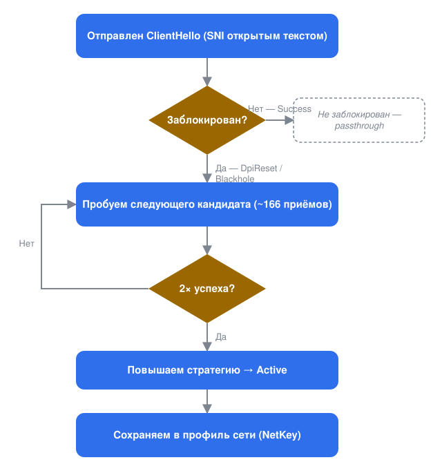

# Bosphorus

[](https://github.com/Dark-Hunter-TR/Bosphorus/actions/workflows/build.yml)

**Самообучающийся движок обхода DPI (глубокой инспекции пакетов) для Windows.**
Bosphorus следит за вашими исходящими HTTPS-соединениями, автоматически
подбирает, какая манипуляция с пакетами обходит цензора *вашей* сети для
*каждого* сайта, закрепляет найденный приём и запоминает его по сетям — без
какой-либо ручной настройки.

**Languages:** [English](README.md) · [Türkçe](README.tr.md) · **Русский**

> ⚠️ **Юридическая оговорка.** Bosphorus — инструмент для сетевых
> исследований и обхода цензуры. Используйте его только в сетях и на трафике,
> на тестирование которых у вас есть право. Соблюдение применимых к вам
> законов и норм — ваша ответственность.

---

## Содержание

- [Что такое Bosphorus](#что-такое-bosphorus)
- [Как это работает, вкратце](#как-это-работает-вкратце)
- [Как это работает, подробно](#как-это-работает-подробно)
  - [Путь захвата пакетов](#путь-захвата-пакетов)
  - [Отслеживание соединений и вердикты](#отслеживание-соединений-и-вердикты)
  - [Жизненный цикл обнаружения](#жизненный-цикл-обнаружения)
  - [Память по сетям (NetKey)](#память-по-сетям-netkey)
  - [Пул провайдера](#пул-провайдера---isp-name-опционально)
  - [QUIC и HTTP/3](#quic-и-http3)
  - [Переключение сети на лету](#переключение-сети-на-лету)
- [Набор приёмов обхода](#набор-приёмов-обхода)
- [Сетка кандидатов](#сетка-кандидатов)
- [Структура проекта](#структура-проекта)
- [Требования](#требования)
- [Сборка из исходников](#сборка-из-исходников)
- [Выпуск сборки](#выпуск-сборки)
- [Использование из командной строки](#использование-из-командной-строки)
- [Запуск как службы Windows](#запуск-как-службы-windows)
- [Файлы, папки и журналы](#файлы-папки-и-журналы)
- [Безопасность и решения дизайна](#безопасность-и-решения-дизайна)
- [Ограничения и то, что вне области](#ограничения-и-то-что-вне-области)
- [Благодарности и авторство](#благодарности-и-авторство)
- [Лицензия](#лицензия)

## Что такое Bosphorus

Многие сети используют middlebox, который проверяет открытый **SNI** (имя
сервера) в TLS `ClientHello` и сбрасывает или блокирует соединения к
запрещённым хостам. Такие инструменты, как **GoodbyeDPI** и **zapret**,
обходят это, разбивая, переупорядочивая или маскируя этот первый пакет так,
чтобы middlebox никогда не увидел чистый SNI, а настоящий сервер — увидел. Но
они ожидают, что *вы сами* подберёте стратегию и понадеётесь, что она
сработает против цензора именно вашего провайдера.

Bosphorus избавляет от этого шага. Он наблюдает, учится и запоминает
автоматически — см. [как это работает](#как-это-работает-вкратце) ниже.

Поставляется как Cargo workspace: переносимое ядро движка, тонкая обёртка
над WinDivert и CLI, который также умеет устанавливать себя как службу
Windows.

## Как это работает, вкратце



1. **Наблюдение.** Самый первый пакет HTTPS-соединения — `ClientHello`,
   несущий имя сайта открытым текстом — пропускается без изменений, а
   Bosphorus следит за тем, что придёт в ответ.
2. **Обнаружение.** Обычный ответ означает, что сайт не заблокирован — больше
   ничего не происходит. Сброс соединения или тишина помечают сайт как
   заблокированный.
3. **Поиск.** Для заблокированного сайта Bosphorus автоматически
   перебирает список примерно из 166 приёмов с пакетами — разбивку
   рукопожатия, отправку ложных пакетов, игры с TTL пакета. Он никогда не
   открывает собственных тестовых соединений: используются только повторные
   попытки, которые и так делает ваш браузер или приложение.
4. **Закрепление.** Первый приём, который дважды подряд доказал свою
   работоспособность для этого сайта, сохраняется и используется для всех
   последующих соединений с ним.
5. **Запоминание.** Изученные приёмы записываются в небольшой файл,
   привязанный к текущей сети. Вернувшись в эту Wi-Fi сеть позже, вы уже
   получите готовые настройки — заново учиться с нуля не нужно.

Остальная часть этого раздела описывает механику; переходите сразу к
[набору приёмов обхода](#набор-приёмов-обхода), если вам нужен только их
список.

## Как это работает, подробно

Каждый пакет — входящий или исходящий — проходит через один хэндл WinDivert
и три внутренних этапа:

- **conntrack** превращает сырые пакеты одного соединения в вердикт: прошло
  ли рукопожатие успешно, было ли сброшено или истекло по таймауту?
- **discovery** использует этот вердикт, чтобы выбрать следующего кандидата
  из сетки для конкретного сайта или закрепить уже доказавший себя приём.
- **transforms** превращает выбранную стратегию в реальный набор пакетов,
  отправляемых вместо (или вместе с) оригинальным.

Всё, что изучает discovery, периодически записывается в небольшой JSON-файл,
привязанный к текущей сети (см. [NetKey](#память-по-сетям-netkey)).

### Путь захвата пакетов

Один хэндл WinDivert на уровне `NETWORK` захватывает намеренно узкий срез
трафика (фрагменты фильтра, взятые дословно из GoodbyeDPI):

- **Исходящий** TCP на порт 443, похожий на запрос или TLS-рукопожатие
  (полезная нагрузка меньше 1200 байт, либо начинается с `GET `/`POST`, либо
  с заголовка TLS-записи).
- **Входящий** с порта 443, несущий сигнал вердикта: `SYN`+`ACK` (по его TTL
  определяется стек сервера и число хопов), `RST`, или первый сегмент данных,
  начинающийся с `0x16` (`ServerHello`).
- Loopback и приватные/link-local диапазоны адресов исключены с обеих сторон.

Всё остальное на машине не затрагивается. Не-IP и не-TCP пакеты проходят
насквозь. Цикл обработки каждого пакета выполняется внутри `catch_unwind`,
так что один повреждённый пакет приводит лишь к одной строке в логе, а не к
падению процесса.

### Отслеживание соединений и вердикты

Каждый захваченный пакет обновляет конечный автомат состояния для своего
соединения. Как только исход становится ясен, соединению присваивается
класс:

| Вердикт | Значение |
|---|---|
| `Success` | Рукопожатие прошло **и удержалось** — либо пошли реальные данные, либо истекло короткое льготное окно без разрыва соединения. |
| `DpiReset` | `RST` пришёл от сервера после нашего `ClientHello`, до какого-либо `ServerHello` — классический сброс "по пути". |
| `LateReset` | `ServerHello` прошёл, но затем сброс разорвал соединение в пределах льготного окна — цензор с "отложенным сбросом". Считается неудачей. |
| `Blackhole` | `ClientHello` отправлен, в ответ не пришло вообще ничего. |
| `TlsError` | Сбой установления соединения, не являющийся чистым сбросом DPI. |
| `Inconclusive` | Ничего решающего не произошло до истечения времени жизни соединения. |

`Success` намеренно откладывается на короткое (~1 с) льготное окно, чтобы
цензор, пропускающий `ServerHello` и *затем* сбрасывающий соединение, был
пойман как `LateReset`, а не преждевременно засчитан как успех. Реальные
входящие данные немедленно прерывают это ожидание.

### Жизненный цикл обнаружения

Discovery отслеживает состояние **по каждой цели** — целью является имя
сайта (SNI) из `ClientHello`, приведённое к нижнему регистру. Рукопожатие
без читаемого имени сайта (уже фрагментированное, либо использующее
Encrypted Client Hello) никогда не трогается и никогда не становится целью.

Цель проходит через четыре фазы:


1. **Probe (проба)** — первое соединение к новому сайту проходит без
   изменений, чтобы понять, действительно ли он заблокирован. Успех
   переводит цель в **Active** без какой-либо стратегии. `DpiReset` или
   `Blackhole` переводят её в **Discover**.
2. **Discover (обнаружение)** — сетка перебирается по одному кандидату за
   раз. Параллельные соединения к одному и тому же сайту получают *разных*,
   ещё не испробованных кандидатов одновременно, так что перебор идёт так же
   быстро, как повторяет попытки само приложение. Как только *один
   конкретный* кандидат добивается двух собственных успехов подряд (успех
   другого кандидата в параллельном соединении в счёт не идёт), он
   повышается, а цель переходит в **Active**.
3. **Active (активна)** — повышенная стратегия (или простой пропуск, для
   сайта, который никогда не был заблокирован) используется для каждого
   соединения. Три неудачи подряд понижают её обратно в **Discover**, и
   перебор начинается заново.
4. **Exhausted (исчерпана)** — все кандидаты испробованы, ни один не сработал.
   Если более поздняя сборка добавляет более крупную сетку, исчерпанная цель
   автоматически возрождается в **Discover**, чтобы попробовать только новых
   кандидатов — старые попытки не повторяются.

Несколько деталей, делающих перебор практичным:

- **Временные сбои прощаются один раз.** `DpiReset` (намеренный сброс) сразу
  исключает кандидата, но `Blackhole` — который может быть просто временной
  потерей пакетов — получает ещё одну попытку перед исключением.
- **Учёт повторных передач.** Как только стратегия была отправлена для
  соединения, последующая повторная передача того же `ClientHello`
  пересылается без изменений, так что он никогда не десинхронизируется
  дважды (это только повредило бы его сильнее).
- **Ограниченная память.** Простаивающие, никогда не блокировавшиеся цели
  удаляются через 24 часа, любая цель — через 7 дней, а жёсткий предел в 4096
  отслеживаемых целей соблюдается с приоритетом на удаление наименее ценных —
  так что служба, работающая неделями, не накапливает по записи на каждый
  когда-либо посещённый сайт.

### Память по сетям (NetKey)

Изученное состояние сохраняется как один JSON-файл на сеть. **NetKey** — это
хэш от адреса шлюза, подсети и DNS-суффикса, выбранный так, чтобы VPN или
виртуальный адаптер, который просто оказывается первым в списке адаптеров,
не давал неверный ключ.

- Сохраняются только цели, которые стоит переучивать заново: перебор в
  процессе, повышенная стратегия или исчерпанная цель. Сайты, которые
  никогда не были заблокированы, ничего не стоит выяснить заново, поэтому
  они вообще не записываются.
- Если сетка меняется между сборками (кандидаты добавлены или
  переупорядочены), устаревшие записи деградируют аккуратно — Bosphorus
  сохраняет то, что может (например, изученный TTL), вместо того чтобы
  доверять перенумерованным идентификаторам.
- **Файл одной сети никогда не удаляется и не объединяется с другим.**
  Перемещайтесь между домом, офисом и точкой доступа телефона месяцами — и
  каждая сеть сохраняет ровно то, что она изучила, не затрагивая другие.

### Пул провайдера (`--isp NAME`, опционально)

Память NetKey привязана к конкретной *сети*. `--isp NAME` добавляет
необязательный слой поверх: он объединяет стратегии, сработавшие во всех
сетях, помеченных вами одним именем, и предлагает их — осторожно — **новой**
сети под этой же меткой, ещё до перебора неопробованной сетки.

- **Производный, никогда не авторитетный.** Файл пула перестраивается из
  ваших профилей по сетям; удаление его означает лишь холодный старт, никакое
  изученное состояние фактически не теряется.
- **Самый слабый уровень посева.** В отличие от подсказки в рамках той же
  сети, кандидат из пула провайдера не пропускает первоначальную пробу и
  требует обычного порога в два успеха для повышения.
- **Требуется подтверждение.** Стратегия предлагается только после того, как
  доказала себя как минимум **на двух разных сетях** под этой меткой, с
  устойчивым общим процентом успеха.
- Метка — это то, как вы сами решите её назвать. Bosphorus никогда сам не
  определяет вашего провайдера. Ошибиться в названии стоит лишь одну
  потраченную впустую попытку.

### QUIC и HTTP/3

Всё описанное выше работает с TLS поверх TCP. Но современный браузер часто
обращается к сайту по **QUIC** — а цензор, блокирующий сайт, обычно блокирует
его и там. Браузер остаётся на протоколе, с которым Bosphorus помочь не может,
и сайт не открывается, даже если рабочая стратегия для TCP уже изучена.

Равноценного приёма для QUIC-рукопожатия не существует: имя сайта внутри него
зашифровано, так что нечего ни разбивать, ни маскировать, ни сдвигать. Вместо
этого Bosphorus **отклоняет попытку QUIC**, из-за чего браузер откатывается на
TCP — тот путь, ответ для которого у него *есть*.

К кому это применяется — и есть самое главное:

| `--quic` | Что происходит |
|---|---|
| `blocked` *(по умолчанию)* | HTTP/3 теряют только те адреса, на которых цензор был реально пойман на сбросе соединения. Всё остальное его сохраняет. |
| `all` | Отклоняется каждое HTTP/3-соединение на машине — подход GoodbyeDPI. Обучения не требует; стоит QUIC повсюду. |
| `off` | QUIC не трогается вообще. Заблокированный сайт может продолжать не открываться по HTTP/3. |

По умолчанию адрес отмечается только **настоящим сбросом** (`DpiReset` или
`LateReset`), увиденным на стороне TCP — тишина доказательством не считается,
поскольку неотличима от обычной потери пакетов. Отметки истекают сами примерно
через пятнадцать минут, так что сеть, переставшая цензурировать, возвращает
HTTP/3 без всякого перезапуска; кроме того, они хранятся отдельно для каждой
сети и никогда не пишутся на диск, ведь адрес, изученный за CDN, довольно
скоро принадлежит кому-то другому.

Единицей здесь является адрес, а не имя хоста, потому что QUIC-рукопожатие не
несёт читаемого имени. Поэтому заблокированный хост, делящий адрес CDN с
разрешёнными, стоит HTTP/3 и им — они откатываются на TCP и продолжают
работать, просто без выигрыша QUIC в скорости.

### Переключение сети на лету

Роуминг между Wi-Fi сетями, переключение VPN или обновление аренды DHCP —
всё это запускает перепроверку. После короткой задержки-дебаунса Bosphorus
пересчитывает NetKey; если он изменился, изученное состояние старой сети
сбрасывается в её собственный файл, загружается файл новой сети (если он
существует), а устаревшее состояние соединений очищается — без перезапуска и
без потери трафика в процессе. Вместе с ней забывается и то, на чём был пойман
цензор старой сети.

## Набор приёмов обхода

**Стратегия** — это рецепт, применяемый к одному `ClientHello`. Она собрана
из следующих компонентов, комбинируемых сеткой обнаружения:

**Ложный пакет (decoy)** — дополнительный пакет, отправляемый рядом с
настоящим, принимаемый middlebox, но отбрасываемый настоящим сервером:

| Метод | Что делает |
|---|---|
| `WrongSeq` | Ложный пакет со сдвинутым в прошлое номером последовательности. |
| `WrongChecksum` | Ложный пакет с намеренно повреждённой TCP-контрольной суммой. |
| `TtlLimited` | Ложный пакет с низким TTL, чтобы он истёк до достижения настоящего сервера. |
| `SeqPlusTtl` | `WrongSeq` в сочетании с низким TTL. |
| `ChecksumPlusTtl` | `WrongChecksum` в сочетании с низким TTL. |
| `OverlapDisorder` | Без отдельного ложного пакета: настоящее рукопожатие разбивается и отправляется не по порядку, причём вторая половина снабжена мусорными байтами спереди, которые отбрасывает только сервер по принципу "побеждает последний полученный". Только по явному включению. |

**Фрагментация** — разбивка TCP-полезной нагрузки в одной или нескольких
точках: ровно на фиксированном смещении в байтах, сразу после заголовка
TLS-записи, прямо перед именем сайта, или посередине него. Разбивка более
чем в одной точке даёт более двух частей; части можно опционально отправить
в обратном порядке.

**Ложная полезная нагрузка** — дословный статичный `ClientHello` из
GoodbyeDPI, либо "агрессивный" вариант, дополнительно дополненный, чтобы
вытолкнуть буфер пересборки middlebox за его предел.

**Политика TTL для ложного пакета.** Bosphorus может использовать значение,
заданное вами вручную; грубую авто-оценку, основанную на измеренном числе
хопов до настоящего сервера; либо, как только для конкретного сайта
действительно был замечен сброс от DPI, — *точно измеренное* расстояние до
устройства, отправившего этот сброс, считанное прямо с TTL самого этого
пакета сброса, точно так же, как число хопов сервера считывается с его
`SYN`+`ACK`. Это измерение автоматически заменяет собой грубую оценку, без
какой-либо настройки, и только для того сайта, для которого оно было
измерено.

**Заполнение TLS** — расширение заполнения по RFC 7685, добавляемое к
`ClientHello` перед фрагментацией, увеличивающее запись сверх того
фиксированного буфера, который выделяет логика пересборки DPI.

**Порядок отправки и повторы** — сначала ложный пакет, затем настоящий, или
наоборот; опционально отправка ложного пакета более одного раза.

**Учёт стека сервера.** `OverlapDisorder` работает только против сервера,
который сохраняет *последнюю* копию перекрывающихся данных из полученных.
Bosphorus определяет стек сервера по TTL его `SYN`+`ACK` и никогда не
предлагает вариант с перекрытием серверу Windows-типа, побеждает первый
полученный.

## Сетка кандидатов

Сетка по умолчанию — **166 стратегий**, упорядоченных так, что приёмы,
которые чаще всего срабатывают, пробуются первыми:

| Семейство | Количество | Из чего построено |
|---|---|---|
| Одиночный разрыв + ложный пакет | 142 | 7 точек разрыва × {прямой, обратный порядок} × 6 видов ложного пакета × {1, 2} повтора, с устранением дублей. |
| Многочастевой нативный разрыв | 12 | 3 отобранных схемы разреза × {прямой, обратный порядок} × {без ложного пакета, ложный пакет с неверной последовательностью}. |
| Заполнение по RFC 7685 | 6 | 3 точки разрыва × {неверная последовательность, неверная контрольная сумма} ложного пакета, заполнение 512 байт. |
| "Агрессивный" ложный пакет | 6 | Больший дополненный ложный пакет × 3 точки разрыва × {неверная последовательность, неверная контрольная сумма}. |
| Перекрытие/беспорядок | +8 | Только по явному включению (`--enable-overlap`) → всего 174. 4 точки разрыва × 2 размера перекрытия. |

Выполните `bosphorus --engine --strategy list`, чтобы вывести точную сетку,
поставляемую с вашей сборкой.

## Структура проекта

Cargo workspace из трёх крейтов:

| Крейт | Роль |
|---|---|
| `bosphorus-core` | Движок: разбор пакетов, отслеживание соединений, модель стратегий, генератор сетки, планировщик discovery, хранение состояния по сетям. Не зависит от платформы — никакой зависимости от WinDivert или Windows API. |
| `bosphorus-divert` | Тонкая, без выделений памяти, безопасная обёртка вокруг WinDivert 2.2. |
| `bosphorus-cli` | Бинарник `bosphorus`. Связывает бэкенд WinDivert с ядром движка, добавляет хост службы Windows, вычисление ключа сети, отслеживание смены маршрута, логирование и переведённый каталог сообщений CLI. |

## Требования

- **Windows x64.**
- **Права администратора** для всего, что открывает драйвер WinDivert
  (`--engine`, `--selftest`, `--passthru`, `--observe`, `service install`).
  `--check-filters`, `--discovery-demo`, `--mem-bench` и `service status` не
  требуют повышения прав.
- **Драйвер WinDivert 2.2.2 должен загружаться.** HVCI/Memory Integrity,
  Smart App Control или политика WDAC могут молча заблокировать при загрузке
  системы драйвер, который в их глазах не подписан. `service install`
  проверяет загрузку драйвера перед регистрацией службы и отказывает (либо
  предупреждает, с `--force`), если это не удаётся.
- **Стабильный путь установки.** WinDivert регистрирует свой драйвер оттуда,
  где находится `bosphorus.exe`; перемещение исполняемого файла позже ломает
  и службу, и драйвер вместе с ней. Держите его в постоянном месте, либо
  используйте `service install --install-dir`.
- **Rust (stable, 1.80 или новее)** с целью `x86_64-pc-windows-msvc`, для
  сборки из исходников.

## Сборка из исходников

> **Нет под рукой машины с Windows?** Каждый push в `main`, каждый pull
> request и каждый ручной запуск workflow [`build`](../../actions/workflows/build.yml)
> компилирует `bosphorus.exe` на размещённом GitHub Windows-раннере и
> загружает его — вместе с `WinDivert.dll` и `WinDivert64.sys` — как
> скачиваемый артефакт workflow. Откройте страницу **Summary** последнего
> зелёного запуска и заберите `bosphorus-windows-x64` в разделе
> **Artifacts**. Локальный набор инструментов Rust или загрузка WinDivert не
> требуются. Чтобы собрать *конкретную версию*, см.
> [выпуск сборки](#выпуск-сборки).

1. **Получите бинарники WinDivert 2.2.2.** Скачайте официальный
   `WinDivert-2.2.2-A.zip` из релиза v2.2.2 `basil00/WinDivert` и распакуйте
   так, чтобы существовал этот путь:

   ```
   assets/WinDivert-2.2.2-A/x64/WinDivert.dll
   assets/WinDivert-2.2.2-A/x64/WinDivert64.sys
   assets/WinDivert-2.2.2-A/x64/WinDivert.lib
   ```

   `assets/` в git-ignore. `.cargo/config.toml` уже указывает
   `WINDIVERT_PATH` на эту папку как путь относительно корня workspace;
   переключите на абсолютный путь, если ваш Cargo достаточно старый, чтобы
   неверно его обрабатывать.

2. **Сборка.**

   ```powershell
   cargo build --release                 # повседневная оптимизированная сборка
   cargo build --profile release-dist    # поставляемый артефакт: полный LTO, без символов
   ```

3. **Тесты.**

   ```powershell
   cargo test                            # модульные и интеграционные тесты, без повышения прав
   ```

## Выпуск сборки

Версии задаются вручную, по одному крейту за раз, из workflow
[`manual build`](../../actions/workflows/manual-build.yml) — **Run workflow**,
заполните только те крейты, которые изменились, остальные оставьте пустыми.

| Крейт | Что это | Когда повышать |
|---|---|---|
| `bosphorus-core` | Движок: отслеживание соединений, обнаружение, стратегии, хранение. | Изменилось поведение обнаружения или обхода. |
| `bosphorus-divert` | Обёртка вокруг WinDivert. | Изменился слой захвата/инжекции. |
| `bosphorus-cli` | Сам `bosphorus.exe`. **Даёт имя релизу.** | Всё, что заметит пользователь бинарника. |

Пустое поле означает, что крейт сохраняет свой текущий номер: исправление,
затрагивающее только движок, может выйти как core `0.2.0`, пока бинарник
остаётся `0.1.0`. `bosphorus.exe --version` печатает обе версии, так что по
отчёту об ошибке видно, какой движок внутри какой сборки.

**Mode** определяет, чего стоит запуск:

- **`test`** — собирает, прогоняет тесты и оставляет скачиваемый артефакт,
  названный по версиям и коммиту. Ничего не коммитится, не тегируется и не
  публикуется, так что версию можно попробовать, не потратив её.
- **`release`** — делает всё то же самое, затем коммитит изменения версий,
  ставит тег `v<версия bosphorus-cli>` и публикует GitHub Release. Запуск не
  начнётся, если такой тег уже есть, так что релиз всегда получает свежий
  номер.

Версии двигаются только вперёд: workflow отклонит номер ниже того, который
крейт уже несёт.

## Использование из командной строки

```
bosphorus <command> [options]
```

**`--engine [--secs N] [--strategy S] [--enable-overlap] [--quic P] [--profile-dir DIR] [--isp NAME]`**
*Требует прав администратора.* Запускает движок. Без `--strategy` это полное
автоматическое обнаружение с сохранением состояния по сетям и обработкой
переключения сети на лету. С `--strategy` вместо этого принудительно
используется одна фиксированная стратегия (не привязана ни к какой сети, не
сохраняется). `--secs N` останавливает работу автоматически через N секунд —
иначе останавливайте через `Ctrl+C`. `--profile-dir` переопределяет, откуда
читаются и куда записываются профили. `--isp NAME` подключает
[пул провайдера](#пул-провайдера---isp-name-опционально).
`--quic off|blocked|all` выбирает [политику QUIC](#quic-и-http3)
(по умолчанию `blocked`).

**`--check-filters`**
*Повышение прав не требуется.* Строит строки фильтра WinDivert и проверяет
их синтаксис.

**`--discovery-demo [--fresh]`**
*Повышение прав не требуется.* Демонстрация без драйвера, доказывающая, что
цикл discovery работает и его прогресс переживает перезапуски процесса.
`--fresh` сначала стирает демонстрационный профиль.

**`--mem-bench [N]`**
*Повышение прав не требуется.* Прогоняет движок с `N` синтетическими целями
(по умолчанию 2000) и выводит его потребление памяти.

**`--observe [--secs N]`**
*Требует прав администратора.* Только анализ — прослушивает весь TCP- и
UDP-трафик, ничего не меняет и выводит сводную таблицу по целям. Полезно,
чтобы увидеть, к чему на самом деле подключается приложение.

**`--passthru [--secs N]`**
*Требует прав администратора.* Захватывает каждый TCP-пакет на `:443`,
логирует его и переинжектирует без изменений — дымовой тест, доказывающий,
что захват и переинжекция не ломают интернет.

**`--selftest`**
*Требует прав администратора.* Проверочный стенд для WinDivert: проверяет
обработку новых потоков, размеры `ClientHello`, обработку контрольных сумм и
загрузку драйвера.

**`--selftest-m7`**
*Требует прав администратора.* Пробы осуществимости для техники
перекрытия/беспорядка.

**`service <install|uninstall|run|status>`**
*Повышение прав зависит от подкоманды* — см.
[Запуск как службы Windows](#запуск-как-службы-windows).

**Язык.** Этот README переведён на несколько языков, но *собственные*
сообщения программы — на пути `--engine` и в командах службы — сейчас
поставляются только на английском и турецком: английский по умолчанию, или
турецкий, если язык интерфейса Windows — турецкий. Переопределите в любую
сторону через `--lang en|tr` или переменную окружения `BOSPHORUS_LANG`.
Вывод логов для разработчиков и диагностические подкоманды всегда остаются
на английском.

**Уровень логирования.** Задайте переменную окружения `RUST_LOG`, например
`RUST_LOG=bosphorus::discovery=info,bosphorus::strategy=info`.
`bosphorus::mem=debug` включает периодическую сводку по потреблению памяти.

### Грамматика `--strategy`

```
--strategy list                       вывести сетку по умолчанию, по одной на строку
--strategy grid:<i>                    выполнить запись сетки номер <i>
--strategy overlap:<seqovl>/<anchor>   принудительное перекрытие/беспорядок
--strategy <frag>[/<desync>]           собрать стратегию вручную
```

- `<frag>` — одна точка разрыва, список через запятую для многочастевого
  разрыва, либо `none`. Точка разрыва — это смещение в байтах, `sni`,
  `sni-mid` или `tls`.
- `<desync>` — `wrongseq` (по умолчанию), `wrongsum`, `ttl:<value>` или
  `none`.
- Добавьте `+pad:<n>` к любой форме, чтобы принудительно задать `n` байт
  заполнения TLS.

Примеры:

```powershell
bosphorus --engine --strategy sni                 # разрыв прямо перед именем сайта
bosphorus --engine --strategy tls,sni             # разрыв на три части
bosphorus --engine --strategy 2/wrongsum          # разрыв на байте 2, ложный пакет с неверной контрольной суммой
bosphorus --engine --strategy sni-mid/ttl:6       # разрыв внутри имени сайта, ложный пакет с TTL 6
bosphorus --engine --strategy grid:0              # то, что стоит первым в сетке
```

## Запуск как службы Windows

```powershell
# Установка: создаёт и запускает службу "Bosphorus" (LocalSystem,
# автозапуск, перезапуск при сбое). Сначала проверяет загрузку драйвера.
bosphorus service install [--lang en|tr] [--enable-overlap] [--quic P]
                          [--profile-dir <path>] [--install-dir <path>]
                          [--start auto|demand] [--force]

bosphorus service status                # повышение прав не требуется
bosphorus service uninstall [--purge]   # --purge также удаляет сохранённые данные
bosphorus service run                   # только точка входа SCM, не для интерактивного использования
```

- `--install-dir` копирует исполняемый файл и файлы WinDivert в стабильную
  папку и регистрирует службу из этой копии.
- Установщик выводит короткий блок команд PowerShell, подтверждающих, что
  служба и драйвер действительно запустились — стоит выполнить один раз, так
  как блокировка драйвера при загрузке иначе проходит незаметно.
- Служба запускает тот же движок автообнаружения, что и `--engine` без
  `--strategy`, с собственным хранилищем профилей по сетям и папкой
  журналов. События жизненного цикла также записываются в журнал событий
  приложений Windows под именем провайдера `Bosphorus`.

## Файлы, папки и журналы

| Путь | Что это |
|---|---|
| `assets/WinDivert-2.2.2-A/x64/` | Файлы WinDivert, которые вы предоставляете при сборке. |
| `%LOCALAPPDATA%\Bosphorus\profiles\*.json` | Изученные профили для интерактивного запуска `--engine`, по одному файлу на сеть. |
| `%ProgramData%\Bosphorus\profiles\*.json` | То же самое, для службы (`SYSTEM` не может использовать `%LOCALAPPDATA%`). |
| `%ProgramData%\Bosphorus\logs\` | Файлы журнала службы с ротацией. |
| Просмотр событий → Журналы Windows → Приложение, провайдер `Bosphorus` | Следы запуска/остановки службы и сбоев драйвера. |

**Какое хранилище используется?** `--profile-dir`, если вы его передали,
всегда побеждает. В противном случае интерактивный запуск `--engine`
использует общее хранилище службы, если служба установлена и уже имеет
профиль для вашей текущей сети — так что обе стороны никогда не изучают одну
и ту же сеть дважды — а иначе откатывается на собственное хранилище для
текущего пользователя. Одновременный запуск службы и долгой интерактивной
сессии с одним и тем же хранилищем безопасен (запись атомарна), но они могут
перезаписывать инкрементальное обучение друг друга, поскольку профиль — это
кэш, а не постоянная запись.

Проверьте работающий экземпляр из PowerShell:

```powershell
Get-Service Bosphorus
Get-WinEvent -ProviderName Bosphorus
Get-ChildItem "$env:ProgramData\Bosphorus\profiles\*.json" | Select Name, LastWriteTime
```

## Безопасность и решения дизайна

- **Интернет должен продолжать работать.** Первое соединение к любому новому
  сайту пропускается без изменений. Не-IP и не-TCP трафик никогда не
  проверяется. `ClientHello` без читаемого имени сайта никогда не изменяется.
  `--passthru` существует как постоянное доказательство того, что
  захват-и-переинжекция прозрачны.
- **Самая рискованная техника — по явному включению.** `OverlapDisorder`
  может испортить рукопожатие против сервера не того типа, поэтому
  автообнаружение никогда не пробует её, если вы не передали
  `--enable-overlap` — и даже тогда она держится в стороне от серверов
  Windows-типа.
- **Чистое завершение работы критично.** Обработчик остановки службы,
  финальное сохранение профиля и очистка драйвера — всё это выполняется во
  время unwind-пути Rust, поэтому релизная сборка сохраняет `panic =
  "unwind"`, а не `"abort"`. Каждый пакет также обрабатывается внутри защиты
  от паники, так что один повреждённый пакет деградирует до строки в логе, а
  не роняет процесс.
- **Сторонние байты помечены как таковые.** Фрагменты фильтра WinDivert и
  статичный ложный `ClientHello` скопированы байт-в-байт из GoodbyeDPI и
  намеренно оставлены такими.
- **Ограниченная память для долгой работы.** Простаивающие цели вытесняются,
  жёсткий предел ограничивает число одновременно отслеживаемых целей, а
  периодическая сводка позволяет наблюдать за потреблением памяти на
  протяжении многодневного запуска.

## Ограничения и то, что вне области

- **Только Windows**, и только TLS поверх TCP на порту 443. Обычный HTTP и
  TLS на других портах не обрабатываются.
- **QUIC/HTTP-3 отклоняется, а не обходится.** Bosphorus может вернуть
  заблокированный сайт на TCP (см. [политику QUIC](#quic-и-http3)), где
  стратегия у него есть, — но стратегий обхода для самого QUIC у него нет,
  потому что имя внутри QUIC-рукопожатия зашифровано и разбивать или
  маскировать там нечего.
- **Перенаправление DNS** пока не реализовано; блокировка на уровне DNS
  только наблюдается, но не исправляется.
- **Фрагментация на уровне IP** была оценена и намеренно отложена (слишком
  высокий риск "чёрной дыры", не проверено на Windows).
- **Domain fronting** вне области — он требует содействия со стороны
  клиентского приложения, которое одна лишь манипуляция пакетами дать не
  может.
- **Соединения Encrypted Client Hello (ECH)** не несут читаемого имени
  сайта, так что discovery не за что зацепиться; они пропускаются без
  изменений.

## Благодарности и авторство

- **[GoodbyeDPI](https://github.com/ValdikSS/GoodbyeDPI)** от ValdikSS —
  фрагменты фильтра WinDivert и статичный ложный `ClientHello` используются
  дословно; техники ложных пакетов смоделированы по его образцу.
- **[zapret](https://github.com/bol-van/zapret)** от bol-van — техника
  перекрытия/беспорядка и форма авто-эвристики TTL.
- **[WinDivert](https://github.com/basil00/WinDivert)** от basil00 —
  драйвер захвата/инжекции пакетов, поставляется отдельно под собственной
  лицензией.
- Крейт `windivert-sys` для FFI-привязок.

## Лицензия

Двойная лицензия **MIT OR Apache-2.0**, на ваш выбор (как объявлено в
`Cargo.toml`). WinDivert распространяется на собственных условиях — см.
`assets/WinDivert-2.2.2-A/LICENSE`.
