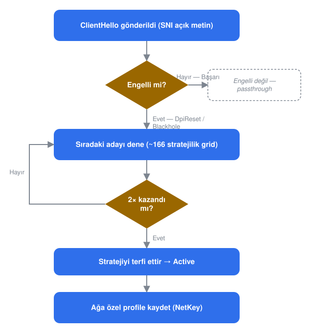

# Bosphorus

[](https://github.com/Dark-Hunter-TR/Bosphorus/actions/workflows/build.yml)

**Windows için kendi kendine öğrenen bir DPI (Derin Paket İncelemesi) atlatma motoru.**
Bosphorus, giden HTTPS bağlantılarınızı izler, *sizin* ağınızda *her* site için
sansürü yenen paket hilesini otomatik olarak bulur, o hileyi kilitler ve ağ
bazında hatırlar — elle hiçbir ayar yapmadan.

**Diller:** [English](README.md) · **Türkçe** · [Русский](README.ru.md)

> ⚠️ **Yasal not.** Bosphorus bir ağ araştırma ve sansür atlatma aracıdır.
> Yalnızca test etme yetkiniz olan ağlarda ve trafikte kullanın. Size
> uygulanan yasa ve düzenlemelere uymaktan siz sorumlusunuz.

---

## İçindekiler

- [Bosphorus nedir](#bosphorus-nedir)
- [Kısaca nasıl çalışır](#kısaca-nasıl-çalışır)
- [Ayrıntılı olarak nasıl çalışır](#ayrıntılı-olarak-nasıl-çalışır)
  - [Yakalama yolu](#yakalama-yolu)
  - [Bağlantı takibi ve kararlar](#bağlantı-takibi-ve-kararlar)
  - [Keşif yaşam döngüsü](#keşif-yaşam-döngüsü)
  - [Ağ bazında hafıza (NetKey)](#ağ-bazında-hafıza-netkey)
  - [ISS tohum havuzu](#iss-tohum-havuzu---isp-name-opt-in)
  - [QUIC ve HTTP/3](#quic-ve-http3)
  - [Canlı ağ değişimi](#canlı-ağ-değişimi)
- [Atlatma araç kutusu](#atlatma-araç-kutusu)
- [Keşif gridi](#keşif-gridi)
- [Proje yapısı](#proje-yapısı)
- [Gereksinimler](#gereksinimler)
- [Kaynaktan derleme](#kaynaktan-derleme)
- [Build almak](#build-almak)
- [Komut satırı kullanımı](#komut-satırı-kullanımı)
- [Windows Hizmeti olarak çalıştırma](#windows-hizmeti-olarak-çalıştırma)
- [Dosyalar, klasörler ve günlükler](#dosyalar-klasörler-ve-günlükler)
- [Güvenlik ve tasarım kararları](#güvenlik-ve-tasarım-kararları)
- [Sınırlamalar ve kapsam dışı](#sınırlamalar-ve-kapsam-dışı)
- [Teşekkürler ve atıf](#teşekkürler-ve-atıf)
- [Lisans](#lisans)

## Bosphorus nedir

Birçok ağ, TLS `ClientHello`'sundaki açık **SNI** (sunucu adı) alanını
inceleyip engelli sitelere giden bağlantıları düşüren ya da sıfırlayan bir
ara kutu (middlebox) çalıştırır. **GoodbyeDPI** ve **zapret** gibi araçlar bu
ilk paketi bölerek, sırasını değiştirerek veya gölgeleyerek bunu yener — ama
size bir strateji seçip ISS'nizin sansürüne uymasını ummanızı bekletirler.

Bosphorus bu adımı ortadan kaldırır: izler, öğrenir ve otomatik olarak
hatırlar — aşağıda [nasıl çalıştığına](#kısaca-nasıl-çalışır) bakın.

Bir Rust workspace'i olarak dağıtılır: taşınabilir bir çekirdek motor, ince
bir WinDivert sarmalayıcısı ve kendini Windows Hizmeti olarak da kurabilen
bir CLI.

## Kısaca nasıl çalışır



1. **İzle.** Bir HTTPS bağlantısının ilk paketi — site adını açık metin olarak
   taşıyan `ClientHello` — dokunulmadan geçirilir ve Bosphorus karşılığında ne
   geldiğini izler.
2. **Tespit et.** Normal bir yanıt, sitenin engellenmediği anlamına gelir;
   başka bir şey olmaz. Bir sıfırlama ya da sessizlik, o siteyi engelli
   olarak işaretler.
3. **Ara.** Engelli bir site için Bosphorus, yaklaşık 166 paket hilesinden
   oluşan bir listeyi otomatik olarak dener — el sıkışmayı bölmek, yem paket
   göndermek, paketin TTL'iyle oynamak. Kendi test bağlantılarını asla açmaz:
   tarayıcınızın ya da uygulamanızın zaten yaptığı yeniden denemeleri
   kullanır.
4. **Kilitle.** O site için üst üste iki kez kendini kanıtlayan ilk hile
   kaydedilir ve o siteye açılan her sonraki bağlantıda yeniden kullanılır.
5. **Hatırla.** Öğrenilen hileler, bulunduğunuz ağa bağlı küçük bir dosyaya
   yazılır. O Wi-Fi'ye daha sonra tekrar katıldığınızda hileler zaten
   hazırdır — hiçbir şey sıfırdan yeniden öğrenilmez.

Bu bölümün geri kalanı iç işleyişe iniyor; yalnızca hile listesini görmek
istiyorsanız [atlatma araç kutusuna](#atlatma-araç-kutusu) geçebilirsiniz.

## Ayrıntılı olarak nasıl çalışır

Her paket — gelen ya da giden — tek bir WinDivert tanıtıcısından ve üç iç
aşamadan geçer:

- **conntrack**, bir bağlantının ham paketlerini bir karara dönüştürür:
  handshake başarılı mı oldu, sıfırlandı mı, yoksa zaman mı aşıldı?
- **keşif**, bu kararı kullanarak o site için grid'den bir sonraki adayı
  seçer, ya da zaten kendini kanıtlamış birini kilitler.
- **dönüşümler**, seçilen stratejiyi, orijinal paketin yerine (ya da
  yanında) gönderilecek gerçek paket yığınına çevirir.

Keşfin öğrendiği her şey, o an bağlı olduğunuz ağa göre anahtarlanmış küçük
bir JSON dosyasına periyodik olarak yazılır (bkz.
[NetKey](#ağ-bazında-hafıza-netkey)).

### Yakalama yolu

`NETWORK` katmanındaki tek bir WinDivert tanıtıcısı, bilinçli olarak dar bir
trafik dilimini yakalar (filtre parçaları GoodbyeDPI'dan bire bir alınmıştır):

- **443** portuna giden, istek ya da TLS handshake'ine benzeyen **giden** TCP
  (yük 1200 bayttan küçük, ya da `GET `/`POST` ile başlıyor, ya da bir TLS
  kayıt başlığı).
- 443 portundan gelen ve bir karar sinyali taşıyan **gelen** trafik: `SYN`+`ACK`
  (TTL'i sunucunun yığınını ve atlama sayısını söyler), bir `RST`, ya da
  `0x16` ile başlayan ilk veri segmenti (bir `ServerHello`).
- Loopback ve özel/link-local adres aralıkları her iki yönde de dışlanır.

Makinedeki diğer her şeye dokunulmaz. IP olmayan ve TCP olmayan paketler
doğrudan geçer. Paket başına döngü `catch_unwind` içinde çalışır; bozuk tek
bir paket süreci öldürmek yerine tek satırlık bir günlüğe düşer.

### Bağlantı takibi ve kararlar

Yakalanan her paket, bağlantı bazında bir durum makinesini günceller. Sonuç
kesinleştiğinde bağlantı sınıflandırılır:

| Karar | Anlamı |
|---|---|
| `Success` | Handshake geçti **ve tuttu** — ya gerçek veri aktı, ya da kısa bir bekleme penceresi teardown olmadan doldu. |
| `DpiReset` | `ClientHello`'muzdan sonra, herhangi bir `ServerHello` gelmeden sunucudan bir `RST` geldi — klasik yol-içi sıfırlama. |
| `LateReset` | `ServerHello` geçti, ardından bekleme penceresi içinde bir sıfırlama bağlantıyı kopardı — "gecikmeli sıfırlama" yapan bir sansür. Başarısızlık sayılır. |
| `Blackhole` | `ClientHello` gönderildi, hiçbir yanıt gelmedi. |
| `TlsError` | Temiz bir DPI sıfırlaması olmayan bir kurulum hatası. |
| `Inconclusive` | Belirleyici bir şey olmadan bağlantı zaman aşımına uğradı. |

`Success` bilinçli olarak kısa (~1 sn) bir bekleme penceresiyle ertelenir;
böylece `ServerHello`'yu geçirip *sonra* bağlantıyı sıfırlayan bir sansür,
erkenden başarı sayılmak yerine `LateReset` olarak yakalanır. Gerçek gelen
veri bu beklemeyi hemen kısa keser.

### Keşif yaşam döngüsü

Keşif, durumu **hedef bazında** izler; hedef, `ClientHello`'dan gelen küçük
harfe çevrilmiş site adıdır (SNI). Okunabilir bir site adı olmayan bir
handshake (zaten parçalanmış, ya da Şifreli Client Hello kullanan) asla
dokunulmaz ve asla hedef olmaz.

Bir hedef dört fazdan geçer:


1. **Probe** — yeni bir siteye ilk bağlantı, gerçekten engelli olup olmadığını
   görmek için değiştirilmeden geçer. Başarı, hedefi strateji gerektirmeden
   **Active**'e taşır. Bir `DpiReset` ya da `Blackhole`, hedefi
   **Discover**'a taşır.
2. **Discover** — grid bir seferde bir aday olacak şekilde taranır. Aynı
   siteye eşzamanlı bağlantılara *farklı*, denenmemiş adaylar verilir; böylece
   tarama, uygulamanın kendi yeniden denemeleri kadar hızlı ilerler. *Tek bir*
   belirli aday üst üste iki kez kendi başarısını ürettiğinde (paralel bir
   bağlantıda başka bir adayın bir kez başarması buna sayılmaz), o aday terfi
   eder ve hedef **Active**'e taşınır.
3. **Active** — terfi eden strateji (ya da hiç engellenmemiş bir site için düz
   geçiş) her bağlantıda kullanılır. Üst üste üç başarısızlık, hedefi tekrar
   **Discover**'a düşürür ve tarama yeniden başlar.
4. **Exhausted** — her aday denendi ve hiçbiri işe yaramadı. Daha sonraki bir
   sürüm daha büyük bir grid gönderirse, tükenmiş bir hedef otomatik olarak
   **Discover**'a canlanır ve yalnızca yeni adayları dener — eski denemeler
   tekrarlanmaz.

Taramayı pratik kılan birkaç ayrıntı:

- **Geçici başarısızlıklar bir kez affedilir.** `DpiReset` (kasıtlı bir
  sıfırlama) bir adayı hemen eler, ama anlık paket kaybı olabilen
  `Blackhole`, elenmeden önce bir kez daha denenir.
- **Yeniden iletim farkındalığı.** Bir bağlantı için strateji gönderildikten
  sonra, aynı `ClientHello`'nun sonraki bir yeniden iletimi dokunulmadan
  iletilir; böylece iki kez desync edilip daha da bozulmaz.
- **Sınırlı bellek.** Boşta duran, hiç engellenmemiş hedefler 24 saat sonra,
  herhangi bir hedef 7 gün sonra düşürülür ve 4096 hedeflik sabit bir üst
  sınır en-düşük-değer-önce uygulanır — böylece haftalarca çalışan bir hizmet,
  temas edilen her site için bir kayıt biriktirmez.

### Ağ bazında hafıza (NetKey)

Öğrenilen durum, ağ başına bir JSON dosyası olarak kaydedilir. **NetKey**, ağ
geçidi adresinin, alt ağın ve DNS sonekinin bir hash'idir — adaptör
listenizde yalnızca ilk sırada olan bir VPN ya da sanal adaptörün yanlış bir
anahtar üretmemesi için böyle seçilmiştir.

- Yalnızca yeniden öğrenmeye değer hedefler kaydedilir: devam eden bir
  tarama, terfi etmiş bir strateji, ya da tükenmiş bir hedef. Hiç
  engellenmemiş siteler bedavaya yeniden kurulur, bu yüzden hiç yazılmazlar.
- Sürümler arasında grid değişirse (aday eklenir ya da yeniden sıralanırsa),
  eski girdiler zarifçe düşer — Bosphorus, yeniden numaralandırılmış
  kimliklere güvenmek yerine elindekini (öğrenilmiş bir TTL gibi) korur.
- **Bir ağın dosyası asla silinmez ya da başka biriyle birleştirilmez.**
  Aylarca ev, ofis ve telefon hotspot'u arasında dolaşın; her ağ, diğerlerine
  dokunulmadan tam olarak öğrendiğini korur.

### ISS tohum havuzu (`--isp NAME`, opt-in)

NetKey hafızası *ağ* bazındadır. `--isp NAME`, üstüne isteğe bağlı bir katman
ekler: aynı adı etiketlediğiniz her ağda işe yarayan stratejileri havuzlar ve
bunları — dikkatlice — aynı etiket altındaki **yeni** bir ağa, denenmemiş
grid'den önce sunar.

- **Türetilir, asla otoriter değildir.** Havuz dosyası, ağ bazlı
  profillerinizden yeniden inşa edilir; silmek yalnızca soğuk başlangıç
  demektir, hiçbir öğrenilmiş durum gerçekten kaybolmaz.
- **En zayıf tohum katmanıdır.** Aynı-ağ ipucundan farklı olarak, bir
  ISS-havuzu adayı ilk probe'u atlamaz ve terfi etmek için normal iki-başarı
  eşiğine ihtiyaç duyar.
- **Doğrulama gerekir.** Bir strateji ancak o etiket altında **en az iki
  farklı ağda** kendini kanıtladıysa ve sağlıklı bir genel başarı oranına
  sahipse sunulur.
- Etiket, ona ne isim vermeyi seçtiğinizdir — Bosphorus ISS'nizi asla kendi
  başına çıkarmaz. "Yanlış" etiketlemek en fazla bir israf denemeye mal olur.

### QUIC ve HTTP/3

Yukarıdaki her şey TCP üzerindeki TLS için geçerlidir. Ancak modern bir
tarayıcı bir siteye çoğu zaman **QUIC** üzerinden ulaşır — ve siteyi
engelleyen bir sansürcü genellikle orayı da engeller. Tarayıcı böylece
Bosphorus'un yardım edemeyeceği bir protokolde takılı kalır ve çalışan bir
TCP stratejisi çoktan öğrenilmiş olsa bile site açılmaz.

Bir QUIC el sıkışmasında oynanacak eşdeğer bir oyun yoktur: içindeki site
adı şifrelidir, yani bölünecek, gölgelenecek ya da kaydırılacak bir şey
yoktur. Bosphorus bunun yerine **QUIC denemesini reddeder**; bu da tarayıcıyı
TCP'ye — yani cevabını *bildiği* yola — düşürür.

Bunun kime uygulandığı ise işin bütün özüdür:

| `--quic` | Ne olur |
|---|---|
| `blocked` *(varsayılan)* | Yalnızca bir sansürcünün gerçekten bağlantı sıfırladığı yakalanan hedefler HTTP/3'ü kaybeder. Diğer her şey onu korur. |
| `all` | Makinedeki her HTTP/3 bağlantısı reddedilir — GoodbyeDPI'ın yaklaşımı. Öğrenme gerektirmez; QUIC'i her yerde kaybettirir. |
| `off` | QUIC'e hiç dokunulmaz. Engelli bir site HTTP/3 üzerinden açılmamaya devam edebilir. |

Varsayılanda bir hedef yalnızca TCP tarafında görülen **gerçek bir sıfırlama**
(`DpiReset` ya da `LateReset`) ile işaretlenir — sessizlik kanıt değildir,
çünkü sıradan paket kaybından ayırt edilemez. İşaretler yaklaşık on beş dakika
sonra kendiliğinden düşer, böylece sansürü kesen bir ağ hiçbir şey yeniden
başlatılmadan HTTP/3'ü geri kazanır; ayrıca ağ bazında tutulur ve diske hiç
yazılmazlar, çünkü bir CDN arkasında öğrenilen adres yakında bir başkasına
ait olur.

Buradaki birim alan adı değil adrestir, çünkü bir QUIC el sıkışması okunabilir
bir isim taşımaz. Dolayısıyla bir CDN adresini izinli sitelerle paylaşan
engelli bir site, o sitelere de HTTP/3'e mal olur — onlar TCP'ye düşer ve
çalışmaya devam eder, yalnızca QUIC'in hız avantajı olmadan.

### Canlı ağ değişimi

Wi-Fi'de dolaşmak, bir VPN'i açıp kapatmak ya da bir DHCP kirasını
yenilemek bir yeniden kontrolü tetikler. Kısa bir bekleme (debounce)
sonrasında Bosphorus NetKey'i yeniden hesaplar; değiştiyse, eski ağın
öğrenilen durumu kendi dosyasına boşaltılır, yeni ağın dosyası (varsa)
yüklenir ve eski bağlantı-takip durumu temizlenir — arada yeniden başlatma
yok, kesilen trafik yok. Eski ağın sansürcüsünün yakalanan davranışı da
onunla birlikte düşer.

## Atlatma araç kutusu

Bir **strateji**, tek bir `ClientHello`'ya uygulanan bir tariftir. Keşif
gridi tarafından karıştırılıp eşleştirilen şu parçalardan kurulur:

**Yem paket** — gerçek paketin yanında gönderilen, ara kutunun kabul edip
gerçek sunucunun attığı fazladan bir paket:

| Yöntem | Ne yapar |
|---|---|
| `WrongSeq` | Sıra numarası geçmişe kaydırılmış yem. |
| `WrongChecksum` | Bilerek bozulmuş TCP sağlama toplamına sahip yem. |
| `TtlLimited` | Düşük TTL'li yem; gerçek sunucuya varmadan önce süresi dolar. |
| `SeqPlusTtl` | `WrongSeq` + düşük TTL. |
| `ChecksumPlusTtl` | `WrongChecksum` + düşük TTL. |
| `OverlapDisorder` | Ayrı bir yem yok: gerçek handshake bölünüp sırası bozularak gönderilir, ikinci yarının önüne yalnızca "son alınan kazanır" bir sunucunun attığı çöp baytlar eklenir. Yalnızca isteğe bağlı. |

**Parçalama** — TCP yükünü bir veya daha fazla noktada böl: sabit bir bayt
konumunda, TLS kayıt başlığından hemen sonra, site adından hemen önce, ya da
site adının ortasında. Birden fazla noktada bölmek ikiden fazla parça
üretir; parçalar isteğe bağlı olarak ters sırayla gönderilebilir.

**Yem yük** — GoodbyeDPI'nin bire bir statik `ClientHello`'su, ya da bir ara
kutunun yeniden birleştirme tamponunu sınırının ötesine itmek için daha da
doldurulmuş "agresif" bir varyant.

**Yem için TTL politikası.** Bosphorus, elle sabitlediğiniz bir değeri;
gerçek sunucunun ölçülen atlama sayısından türetilen kaba bir otomatik
tahmini; ya da belirli bir siteden gelen bir DPI sıfırlaması gerçekten
gözlemlendiyse, onu gönderen cihaza olan *tam olarak ölçülmüş* mesafeyi
kullanabilir — bu, tıpkı bir sunucunun atlama sayısının `SYN`+`ACK`'inden
okunması gibi, doğrudan o sıfırlama paketinin kendi TTL'inden okunur. Bu
ölçüm, hiçbir yapılandırma gerekmeden ve yalnızca ölçüldüğü site için, kaba
tahminin yerini otomatik olarak alır.

**TLS dolgusu** — parçalamadan önce `ClientHello`'ya eklenen bir RFC 7685
dolgu uzantısı; kaydı, DPI'nin yeniden birleştirme mantığının ayırdığı sabit
tamponun ötesine büyütür.

**Gönderim sırası ve tekrarlar** — önce-yem-sonra-gerçek ya da tersi;
isteğe bağlı olarak yemi birden fazla kez gönder.

**Sunucu yığını farkındalığı.** `OverlapDisorder`, yalnızca aldığı çakışan
verinin *son* kopyasını tutan bir sunucuya karşı çalışır. Bosphorus, sunucu
yığınını `SYN`+`ACK`'inin TTL'inden okur ve bir Windows tarzı,
ilk-alınanı-kabul-eden sunucuya asla bir overlap adayı vermez.

## Keşif gridi

Varsayılan grid **166 stratejidir** ve en sık işe yarayan hamlelerin önce
denenmesi için sıralanmıştır:

| Aile | Adet | Neyden kurulur |
|---|---|---|
| Tekli bölme + yem | 142 | 7 bölme noktası × {ileri, ters} × 6 yem türü × {1, 2} tekrar, tekilleştirilmiş. |
| Çok parçalı yerel bölme | 12 | 3 seçilmiş kesim deseni × {ileri, ters} × {yem yok, wrong-seq yem}. |
| RFC 7685 dolgusu | 6 | 3 bölme noktası × {wrong-seq, wrong-checksum} yem, 512 baytlık dolgu. |
| "Agresif" yem | 6 | Daha büyük dolgulu yem × 3 bölme noktası × {wrong-seq, wrong-checksum}. |
| Overlap/disorder | +8 | Yalnızca isteğe bağlı (`--enable-overlap`) → toplam 174. 4 bölme noktası × 2 overlap boyutu. |

Derlemenizin gönderdiği tam gridi yazdırmak için
`bosphorus --engine --strategy list` çalıştırın.

## Proje yapısı

Üç crate'lik bir Cargo workspace'i:

| Crate | Rolü |
|---|---|
| `bosphorus-core` | Motor: paket ayrıştırma, bağlantı takibi, strateji modeli, grid üretici, keşif zamanlayıcısı, ağ bazında kalıcılık. Platform bağımsız — WinDivert'e ya da Windows API'lerine bağımlılığı yok. |
| `bosphorus-divert` | WinDivert 2.2 çevresinde ince, tahsissiz (allocation-free) güvenli bir sarmalayıcı. |
| `bosphorus-cli` | `bosphorus` ikili dosyası. WinDivert arka ucunu çekirdek motora bağlar; Windows Hizmeti barındırıcısını, ağ-anahtarı hesabını, rota-değişikliği izlemeyi, günlüklemeyi ve CLI'nin çevrilmiş mesaj kataloğunu ekler. |

## Gereksinimler

- **Windows x64.**
- WinDivert sürücüsünü açan her şey için **Yönetici hakları** (`--engine`,
  `--selftest`, `--passthru`, `--observe`, `service install`).
  `--check-filters`, `--discovery-demo`, `--mem-bench` ve `service status`
  yükseltme gerektirmez.
- **WinDivert 2.2.2 sürücüsü yüklenebilmelidir.** HVCI/Bellek Bütünlüğü,
  Smart App Control ya da bir WDAC politikası, kendi gözlerinde imzasız olan
  bir sürücüyü boot'ta sessizce engelleyebilir. `service install`, hizmeti
  kaydetmeden önce sürücünün yüklendiğini kontrol eder ve yükleyemezse
  reddeder (ya da `--force` ile uyarır).
- **Sabit bir kurulum yolu.** WinDivert, sürücüsünü `bosphorus.exe`'nin
  bulunduğu yerden kaydeder; yürütülebilir dosyayı sonradan taşımak hizmeti
  ve sürücüyü bozar. Kalıcı bir yerde tutun, ya da
  `service install --install-dir` kullanın.
- Kaynaktan derlemek için `x86_64-pc-windows-msvc` hedefli **Rust** (kararlı,
  1.80 veya üzeri).

## Kaynaktan derleme

> **Elinizde Windows makine yok mu?** `main`'e her push, her pull request ve
> [`build`](../../actions/workflows/build.yml) iş akışının her manuel
> çalıştırması, `bosphorus.exe`'yi GitHub'ın barındırdığı bir Windows
> runner'da derler ve (`WinDivert.dll` / `WinDivert64.sys` ile birlikte)
> indirilebilir bir iş akışı çıktısı olarak yükler. En son yeşil çalışmanın
> **Summary** sayfasından **Artifacts** altındaki `bosphorus-windows-x64`'ü
> indirin. Yerel bir Rust kurulumu ya da WinDivert indirmesi gerekmez.
> *Belirli bir sürümü* derlemek için [build almak](#build-almak) bölümüne
> bakın.

1. **WinDivert 2.2.2 ikili dosyalarını edinin.** `basil00/WinDivert` v2.2.2
   sürümünden resmi `WinDivert-2.2.2-A.zip` dosyasını indirin ve şu yol
   oluşacak şekilde açın:

   ```
   assets/WinDivert-2.2.2-A/x64/WinDivert.dll
   assets/WinDivert-2.2.2-A/x64/WinDivert64.sys
   assets/WinDivert-2.2.2-A/x64/WinDivert.lib
   ```

   `assets/` git tarafından yok sayılır. `.cargo/config.toml`, `WINDIVERT_PATH`'i
   zaten workspace kökünden göreli bir yol olarak o klasöre işaret ettirir;
   Cargo'nuz bunu yanlış işleyecek kadar eskiyse mutlak bir yola çevirin.

2. **Derleyin.**

   ```powershell
   cargo build --release                 # günlük optimize derleme
   cargo build --profile release-dist    # dağıtılan çıktı: fat LTO, strip'lenmiş
   ```

3. **Test edin.**

   ```powershell
   cargo test                            # birim + entegrasyon testleri, yükseltme gerekmez
   ```

## Build almak

Sürümler elle, crate başına,
[`manual build`](../../actions/workflows/manual-build.yml) iş akışından
belirlenir — **Run workflow**'a basın, yalnızca değiştirdiğiniz crate'leri
doldurun, gerisini boş bırakın.

| Crate | Nedir | Ne zaman artırılır |
|---|---|---|
| `bosphorus-core` | Motor: bağlantı takibi, keşif, stratejiler, kalıcılık. | Tespit ya da atlatma davranışı değiştiyse. |
| `bosphorus-divert` | WinDivert sarmalayıcısı. | Yakalama/enjeksiyon katmanı değiştiyse. |
| `bosphorus-cli` | `bosphorus.exe`'nin kendisi. **Release'e adını verir.** | Binary'yi kullanan birinin fark edeceği her şey. |

Boş bırakılan kutu, o crate'in mevcut numarasını koruması demektir; yani
yalnızca motoru ilgilendiren bir düzeltme core `0.2.0` olarak çıkarken binary
`0.1.0` kalabilir. `bosphorus.exe --version` ikisini birden yazar, böylece bir
hata bildirimi hangi motorun hangi build'in içinde olduğunu da söyler.

**Mode**, çalışmanın ne anlama geldiğini belirler:

- **`test`** — derler, testleri çalıştırır ve sürümlerle commit'e göre
  adlandırılmış indirilebilir bir çıktı bırakır. Hiçbir şey commit'lenmez,
  etiketlenmez, yayınlanmaz; yani bir sürüm harcanmadan denenebilir.
- **`release`** — bunların hepsini yapar, ardından sürüm değişikliklerini
  commit'ler, `v<bosphorus-cli sürümü>` etiketini atar ve bir GitHub Release
  yayınlar. O etiket zaten varsa hiç başlamaz, böylece her release taze bir
  numara alır.

Sürümler yalnızca ileri gider; iş akışı bir crate'in mevcut numarasından
düşük bir değeri reddeder.

## Komut satırı kullanımı

```
bosphorus <komut> [seçenekler]
```

**`--engine [--secs N] [--strategy S] [--enable-overlap] [--quic P] [--profile-dir DIR] [--isp NAME]`**
*Yönetici gerektirir.* Motoru çalıştırır. `--strategy` yoksa bu, ağ bazında
kalıcılık ve canlı ağ-değişimi işleme ile tam otomatik keşiftir.
`--strategy` ile bunun yerine tek bir sabit strateji zorlanır (hiçbir ağa
bağlı değil, kaydedilmez). `--secs N`, N saniye sonra otomatik durur —
aksi hâlde `Ctrl+C` ile durdurun. `--profile-dir`, profillerin nereden
okunup nereye yazılacağını geçersiz kılar. `--isp NAME`,
[ISS tohum havuzuna](#iss-tohum-havuzu---isp-name-opt-in) opt-in yapar.
`--quic off|blocked|all` ise [QUIC politikasını](#quic-ve-http3) seçer
(varsayılan `blocked`).

**`--check-filters`**
*Yükseltme gerekmez.* WinDivert filtre dizgelerini kurar ve sözdizimlerini
kontrol eder.

**`--discovery-demo [--fresh]`**
*Yükseltme gerekmez.* Keşif döngüsünün çalıştığının ve ilerlemesinin süreç
yeniden başlatmalarına dayandığının sürücüsüz bir kanıtı. `--fresh` önce
demo profilini siler.

**`--mem-bench [N]`**
*Yükseltme gerekmez.* Motoru `N` sentetik hedefle (varsayılan 2000) sürer ve
bellek ayak izini yazdırır.

**`--observe [--secs N]`**
*Yönetici gerektirir.* Yalnızca analiz — tüm TCP ve UDP trafiğini dinler,
hiçbir şeyi değiştirmez ve hedef başına bir özet tablo yazdırır. Bir
uygulamanın gerçekte neye bağlandığını görmek için kullanışlıdır.

**`--passthru [--secs N]`**
*Yönetici gerektirir.* Her `:443` TCP paketini yakalar, günlükler ve
değiştirmeden yeniden enjekte eder — yakalama ve yeniden enjeksiyonun
interneti bozmadığını kanıtlayan bir duman testi.

**`--selftest`**
*Yönetici gerektirir.* WinDivert doğrulama düzeneği: yeni-akış işlemeyi,
`ClientHello` boyutlarını, sağlama toplamı işlemeyi ve sürücünün yüklendiğini
kontrol eder.

**`--selftest-m7`**
*Yönetici gerektirir.* Overlap/disorder tekniği için fizibilite probları.

**`service <install|uninstall|run|status>`**
*Yükseltme alt komuta bağlıdır* — bkz.
[Windows Hizmeti olarak çalıştırma](#windows-hizmeti-olarak-çalıştırma).

**Dil.** Bu README birkaç dile çevrilmiştir, ama *programın kendi* mesajları
— `--engine` yolunda ve hizmet komutlarında — şu an yalnızca İngilizce ve
Türkçe olarak gönderilir: varsayılan olarak İngilizce, Windows arayüz diliniz
Türkçeyse Türkçe. Her iki durumda da `--lang en|tr` ya da `BOSPHORUS_LANG`
ortam değişkeni ile geçersiz kılın. Geliştirici günlük çıktısı ve tanılama
alt komutları her zaman İngilizce kalır.

**Günlük ayrıntısı.** `RUST_LOG` ortam değişkenini ayarlayın, örn.
`RUST_LOG=bosphorus::discovery=info,bosphorus::strategy=info`.
`bosphorus::mem=debug`, periyodik bir bellek-ayak-izi özetini açar.

### `--strategy` dilbilgisi

```
--strategy list                       varsayılan gridi satır satır yazdır
--strategy grid:<i>                    <i> numaralı grid girdisini çalıştır
--strategy overlap:<seqovl>/<anchor>   zorlanmış overlap/disorder
--strategy <frag>[/<desync>]           elle bir strateji kur
```

- `<frag>` = tek bir bölme noktası, çok parçalı bölme için virgülle ayrılmış
  bir liste, ya da `none`. Bir bölme noktası bir bayt konumu, `sni`,
  `sni-mid` ya da `tls`'tir.
- `<desync>` = `wrongseq` (varsayılan), `wrongsum`, `ttl:<değer>`, ya da
  `none`.
- Herhangi bir biçime `+pad:<n>` ekleyerek `n` baytlık bir TLS dolgusu
  zorlayın.

Örnekler:

```powershell
bosphorus --engine --strategy sni                 # site adından hemen önce böl
bosphorus --engine --strategy tls,sni             # üçe bölme
bosphorus --engine --strategy 2/wrongsum          # konum 2'de böl, bozuk-sağlama yemi
bosphorus --engine --strategy sni-mid/ttl:6       # site adının içinde böl, TTL-6 yemi
bosphorus --engine --strategy grid:0              # ilk grid girdisi neyse
```

## Windows Hizmeti olarak çalıştırma

```powershell
# Kurulum: "Bosphorus" hizmetini oluşturur ve başlatır (LocalSystem,
# otomatik başlangıç, hata sonrası yeniden başlatma). Önce sürücünün
# yüklendiğini kontrol eder.
bosphorus service install [--lang en|tr] [--enable-overlap] [--quic P]
                          [--profile-dir <yol>] [--install-dir <yol>]
                          [--start auto|demand] [--force]

bosphorus service status                # yükseltme gerekmez
bosphorus service uninstall [--purge]   # --purge kaydedilmiş veriyi de siler
bosphorus service run                   # yalnızca SCM giriş noktası, etkileşimli kullanım için değil
```

- `--install-dir`, yürütülebilir dosyayı ve WinDivert dosyalarını sabit bir
  klasöre kopyalar ve hizmeti o kopyadan kaydeder.
- Kurulum programı, hizmetin ve sürücünün gerçekten geldiğini doğrulayan
  kısa bir PowerShell komut bloğu yazdırır — bir kez çalıştırmaya değer,
  çünkü boot zamanı bir sürücü engeli aksi hâlde sessizdir.
- Hizmet, `--strategy`'siz `--engine` ile aynı otomatik keşif motorunu, kendi
  ağ bazlı profil deposu ve günlük klasörüyle çalıştırır. Yaşam döngüsü
  olayları ayrıca Windows Application olay günlüğüne `Bosphorus` sağlayıcı
  adıyla yazılır.

## Dosyalar, klasörler ve günlükler

| Yol | Nedir |
|---|---|
| `assets/WinDivert-2.2.2-A/x64/` | Derleme sırasında sağladığınız WinDivert dosyaları. |
| `%LOCALAPPDATA%\Bosphorus\profiles\*.json` | Etkileşimli bir `--engine` çalışması için öğrenilen profiller, ağ başına bir dosya. |
| `%ProgramData%\Bosphorus\profiles\*.json` | Aynısı, hizmet için (`SYSTEM` `%LOCALAPPDATA%` kullanamaz). |
| `%ProgramData%\Bosphorus\logs\` | Döngüsel hizmet günlük dosyaları. |
| Olay Görüntüleyici → Windows Günlükleri → Application, `Bosphorus` sağlayıcısı | Hizmet başlatma/durdurma ve sürücü hatası kırıntıları. |

**Hangi depo kullanılır?** `--profile-dir` verirseniz her zaman kazanır.
Aksi hâlde, etkileşimli bir `--engine` çalışması, hizmet kuruluysa ve mevcut
ağınız için zaten bir profili varsa hizmetin deposunu paylaşır — böylece
ikisi aynı ağı iki kez öğrenmez — yoksa kendi kullanıcıya özel deposuna
düşer. Hizmeti ve uzun bir etkileşimli oturumu aynı depoya aynı anda
çalıştırmak güvenlidir (yazmalar atomiktir) ama birbirlerinin adımsal
öğrenmesini ezebilirler, çünkü profil bir önbellek, kalıcı bir kayıt değil.

Çalışan bir örneği PowerShell'den inceleyin:

```powershell
Get-Service Bosphorus
Get-WinEvent -ProviderName Bosphorus
Get-ChildItem "$env:ProgramData\Bosphorus\profiles\*.json" | Select Name, LastWriteTime
```

## Güvenlik ve tasarım kararları

- **İnternet çalışmaya devam etmeli.** Yeni bir siteye ilk bağlantı
  değiştirilmeden geçirilir. IP olmayan ve TCP olmayan trafik asla
  incelenmez. Okunabilir bir site adı olmayan bir `ClientHello` asla
  değiştirilmez. `--passthru`, yakalama-ve-yeniden-enjeksiyonun şeffaf
  olduğunun sürekli bir kanıtı olarak vardır.
- **En riskli teknik isteğe bağlıdır.** `OverlapDisorder`, yanlış tür bir
  sunucuya karşı handshake'i tıkayabilir; bu yüzden otomatik keşif,
  `--enable-overlap` vermedikçe onu asla denemez — verseniz bile Windows
  tarzı sunuculardan uzak tutulur.
- **Temiz kapanış yük taşır.** Hizmetin durdurma işleyicisi, son profil
  kaydı ve sürücü temizliği hepsi Rust'ın unwind yolunda çalışır; bu yüzden
  yayın derlemesi `"abort"` yerine `panic = "unwind"`'i korur. Her paket de
  bir panik korumasının içinde işlenir; bozuk tek bir paket süreci
  düşürmek yerine bir günlük satırına düşer.
- **Üçüncü taraf baytları öyle işaretlenir.** WinDivert filtre parçaları ve
  statik yem `ClientHello`, GoodbyeDPI'dan bayt bayt kopyalanmıştır ve
  bilerek öyle tutulur.
- **Uzun süreli kullanım için sınırlı bellek.** Boşta duran hedefler
  tahliye edilir, sabit bir üst sınır aynı anda kaç tanesinin izlendiğini
  sınırlar, ve periyodik bir özet günlerce süren bir çalışmada ayak izini
  izlemenizi sağlar.

## Sınırlamalar ve kapsam dışı

- **Yalnızca Windows**, ve yalnızca 443 portunda TLS-üzeri-TCP. Düz HTTP ve
  başka portlardaki TLS işlenmez.
- **QUIC/HTTP-3 atlatılmaz, reddedilir.** Bosphorus engelli bir siteyi TCP'ye
  geri düşürebilir ([QUIC politikası](#quic-ve-http3)) — orada bir stratejisi
  vardır — ama QUIC'in kendisi için bir atlatma stratejisi yoktur, çünkü QUIC
  el sıkışmasındaki isim şifrelidir ve bölünecek ya da gölgelenecek bir şey
  kalmaz.
- **DNS** yönlendirmesi henüz uygulanmadı; DNS bazlı engelleme yalnızca
  gözlemlenebilir, düzeltilmez.
- **IP katmanı parçalama** değerlendirildi ve bilinçli olarak rafa
  kaldırıldı (fazla karadelik riski, Windows'ta doğrulanmadı).
- **Domain fronting** kapsam dışıdır — yalnızca paket manipülasyonunun tek
  başına sağlayamayacağı istemci uygulama iş birliği gerektirir.
- **Şifreli Client Hello (ECH)** bağlantıları okunabilir bir site adı
  taşımaz, bu yüzden keşfin anahtaralayacağı bir şey yoktur; doğrudan
  geçirilirler.

## Teşekkürler ve atıf

- ValdikSS tarafından **[GoodbyeDPI](https://github.com/ValdikSS/GoodbyeDPI)** —
  WinDivert filtre parçaları ve statik yem `ClientHello` bire bir kullanılır;
  yem-paket teknikleri buradan modellenmiştir.
- bol-van tarafından **[zapret](https://github.com/bol-van/zapret)** —
  overlap/disorder tekniği ve otomatik-TTL sezgisel biçimi.
- basil00 tarafından **[WinDivert](https://github.com/basil00/WinDivert)** —
  paket yakalama/enjeksiyon sürücüsü, kendi lisansı altında ayrıca
  paketlenir.
- FFI bağlamaları için `windivert-sys` crate'i.

## Lisans

`Cargo.toml`'da bildirildiği üzere, tercihinize göre **MIT VEYA Apache-2.0**
altında çift lisanslıdır. WinDivert kendi şartları altında dağıtılır — bkz.
`assets/WinDivert-2.2.2-A/LICENSE`.
